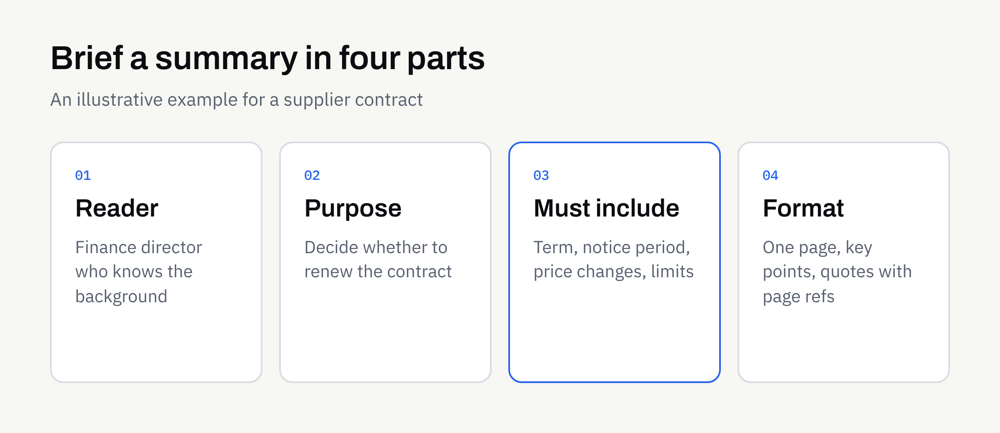

Most businesses have a pile of documents nobody has time to read in full: long reports, contracts, meeting minutes, supplier terms, policy updates. A summary sounds like the obvious fix, and AI-assisted tools can produce one in seconds.

The catch is that a summary is only useful if it answers the question you actually had. A vague request gets a vague result. This guide explains how to ask for a summary you can use, what to settle in advance, and how to check the result before anyone relies on it.

## Why a summary is never neutral

Summarising means choosing what to leave out. Every summary, whether written by a person or produced with AI assistance, reflects decisions about what matters.

That is why "summarise this" is a weak instruction. A finance director, a project manager and a customer service lead would each want a different summary of the same twenty-page report. If you do not say who the summary is for, the tool has to guess, and the guess may not match your needs.

Two risks are worth knowing about from the start:

- **Missing detail:** A deadline, exception or condition may be dropped because it looked minor in a long document.
- **Plausible but wrong wording:** A summary can read smoothly while slightly changing what the original actually says.

Neither risk is a reason to avoid summaries. They are reasons to brief carefully and to check.

## Start with the decision the summary supports

Before you describe the document, describe what you will do with the summary. This is the single most useful thing you can add.

Compare these two requests:

- "Summarise this supplier contract."
- "Summarise this supplier contract so I can decide whether to renew. I need the term, notice period, price-change rules and anything that restricts us."

The second gives a clear purpose and a list of things that must appear. The result is easier to produce and far easier to check.

### Name the reader

Say who will read the summary and how much they already know. A summary for a director who knows the background can be short. A summary for a new team member needs plain explanations of any terms.

### Name the action

Is the summary for deciding, filing, briefing a meeting or replying to someone? Each purpose points to a different shape.

## Choose the right kind of summary

Not every summary is the same type. Picking one up front avoids a lot of rework.

| Type | Best for | What it usually looks like |
| --- | --- | --- |
| Short overview | Deciding whether to read further | A paragraph or a few bullet points |
| Key points and dates | Contracts, notices, policies | A list of terms, deadlines and obligations |
| Section-by-section | Long reports | One short note per heading, in the original order |
| Actions and decisions | Meeting minutes | Who agreed to do what, and by when |
| Questions it raises | Reviewing a document critically | A list of unclear or missing points to follow up |

You can ask for more than one. A short overview on top, with a key-points list underneath, is a common and practical combination.

## Say what must always appear

Think of this as a must-include list. For each type of document, write down the items a reader would be unhappy to miss.

For a supplier contract, that might be the parties, the start and end dates, the notice period and any charges that change. For a policy update, it might be what changed, who is affected and the date it applies from.

Be equally clear about what to leave out. If personal contact details or commercially sensitive figures should not appear in the summary, say so.

### Ask for quotes on anything exact

For deadlines, amounts, names and conditions, ask for the original wording to be quoted, with the section or page it came from. This makes checking quick, because the reader can go straight to the source.

### Ask for gaps to be flagged

Tell the tool, or the supplier running it, to say so when something is missing or unclear rather than guess. "The document does not state a notice period" is far more useful than a confident invention. This is the same principle covered in our guide to [AI document extraction](https://fintaxtech.co.uk/blog/ai-document-extraction-explained/).

## Decide the format and length

Agree the shape before the first run, so you are not editing every result by hand.

- **Length:** For example, "no more than one page" or "five bullet points".
- **Structure:** Headings, a table, or plain paragraphs.
- **Tone:** Plain and neutral for internal use, or written to match your house style for something you will share.
- **Order:** Original order of the document, or ordered by importance.

If the same kind of document arrives regularly, write the brief once and reuse it. Our article on [repeatable AI workflows](https://fintaxtech.co.uk/blog/repeatable-ai-workflows-for-your-business/) explains how to describe a task so it comes out in the same shape each time.

## Prepare the document first

A summary can only be as good as what it is given. Scanned pages that are crooked or faint, files with missing pages, and several versions of the same document all cause trouble.

Before you send anything:

- Check that you have the complete, final version
- Remove duplicates and older drafts
- Make sure scans are readable and in the right order
- Note any pages or sections you already know are not relevant

Our guide to [preparing documents for AI-assisted work](https://fintaxtech.co.uk/blog/prepare-documents-for-ai-assisted-work/) has a fuller tidy-up list.

## Be careful with sensitive documents

Long documents often contain exactly the material you should think hardest about sharing: client details, employee records, financial information or legal correspondence.

Before any document leaves your business, decide whether it needs redacting and whether it should be shared at all. Our article on [using AI with confidential business documents](https://fintaxtech.co.uk/blog/ai-confidential-business-documents/) covers what to share, what to redact and how to transfer files safely.

## Check the summary before you rely on it

Treat the summary as a first draft that a person approves. A simple check is usually enough, and it is quicker than reading the whole document.

### Spot-check the exact items

Take every date, amount, name and condition in the summary and compare it with the original. If quotes and page references were requested, this takes minutes.

### Look for what is not there

Read the original's headings, then ask whether anything important under them is absent from the summary. Omissions are harder to spot than mistakes, so this step matters.

### Test one surprising line

If a sentence in the summary surprises you, find the passage it came from. Surprising lines are where wording has most often drifted.

### Keep the source close

File the summary alongside the original and say clearly which is which. Nobody should act on a summary without being able to reach the document behind it.

For a fuller review routine, see our article on [how to check AI-assisted content before you publish it](https://fintaxtech.co.uk/blog/how-to-review-ai-assisted-content/).

## When a summary is not enough

Some documents should be read in full by a person, whatever a summary says. Contracts with significant obligations, regulatory notices and anything with legal or financial weight fall into this group.

A summary can help you prepare for that reading, and can help you decide what to ask. It should not replace it. This article is not legal advice. If a document carries legal or regulatory consequences, take professional advice and confirm the terms in writing.

## How this works with FinTaxTech

AI Automation at FinTaxTech is a managed service. You describe the job and share the documents once an engagement is in place; we run the workflow and hand over the finished summaries. We do not sell prompts or prompt packs.

Some points to keep in mind:

- **Sensitive material:** Some sensitive or regulated documents may be declined, so raise this early.
- **Secure transfer:** Documents are transferred securely, and only once an engagement is in place.
- **Your approval:** Someone on your side should check each summary before it is relied on.

## Checklist: is your summary request ready?

- [ ] I can say what decision or action the summary supports
- [ ] I have named who will read it and what they already know
- [ ] I have chosen the type of summary: overview, key points, section-by-section or actions
- [ ] I have listed what must always appear, and what must stay out
- [ ] Exact items such as dates and amounts will be quoted, with a page or section
- [ ] Missing or unclear information should be flagged, not guessed
- [ ] Length and format are agreed
- [ ] The document is complete, readable and the final version
- [ ] I have considered whether it needs redacting before sharing
- [ ] A named person will check the summary against the original
- [ ] Documents with legal or regulatory weight will still be read in full

## Next steps

If you have documents that pile up unread and would like to talk through whether a managed summarising workflow suits them, we are happy to have a no-pressure conversation. Bring a typical example and a note of what the reader needs to know.

**[Talk to us about AI summaries →](/enquiry/?service=ai-automation)**
