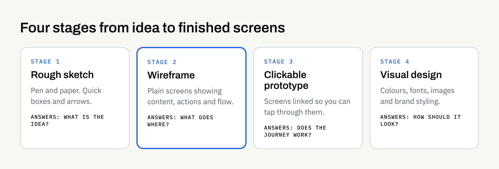

Most app ideas start as a picture in someone's head. The trouble is that the picture in your head and the one in a developer's head are rarely the same, and the difference usually surfaces after money has been spent.

A wireframe is the cheapest way to bring those pictures together. This guide explains what wireframes are, what they should contain and how to check one properly, even if you have never seen one before.

## What is an app wireframe?

A wireframe is a simple, plain sketch of an app's screens. It shows what sits on each screen, roughly where it sits and how someone gets from one screen to the next. It has no brand colours, no photographs and no final wording.

Think of the floor plan of a house. It tells you where the doors, rooms and stairs are before anyone chooses wallpaper. If the kitchen is in the wrong place, that is the moment to find out.

Wireframes also sit between two other stages that people often confuse with them.

## Why bother with wireframes before design or code?

Changes are cheapest at the start. Moving a box on a sketch takes minutes. Changing a built screen can involve design, code and testing.

Wireframes help in four practical ways.

- **They expose missing steps.** What happens if someone forgets their password, or has no connection, or has no orders yet?
- **They keep the discussion on content and flow.** Without colours and fonts, nobody argues about shades of blue.
- **They make quotes easier to compare.** A list of screens is a firmer basis than a paragraph of description. Our guide to [why mobile app quotes vary](https://fintaxtech.co.uk/blog/why-mobile-app-quotes-vary/) explains how much difference a clear scope makes.
- **They protect the launch version.** Seeing every screen written down makes it obvious when the plan has grown beyond the first release.

## What a useful wireframe contains

A good wireframe is plain but not vague. For each screen, expect to see the following.

| Element | What to look for | Question to ask |
| --- | --- | --- |
| Screen name | A clear label such as "Order history" | Is every screen named and listed? |
| Content blocks | Boxes for text, lists, images, buttons | Is anything you expect missing? |
| Actions | Buttons and links, labelled by what they do | Where does each one lead? |
| Navigation | How people move between main areas | Can a first-time user find things? |
| Notes | Short comments on rules or conditions | Are special cases explained? |
| States | Empty, loading and error versions | What does the user see when it goes wrong? |

The last row is the one most often skipped, and it matters. An app with no orders yet, or with no signal, still has to show something sensible.

## From idea to wireframes: a simple sequence

You do not need software to start. This sequence works with a pen and a stack of paper.

1. **Write the goal in one sentence.** For example, "A customer can book a visit in under a minute." Use your own wording.
2. **List the main tasks.** Each task a user must complete becomes a journey to sketch.
3. **List the screens.** Include sign-in, settings and anything the user sees before they have any data.
4. **Sketch each screen as boxes and labels.** Do not worry about neatness.
5. **Draw arrows between screens.** Every button should lead somewhere.
6. **Walk through each task as a customer.** Tap the paper with a finger and say what happens next.

If you are still deciding what belongs in the first release, our article on [MVP versus a full mobile app](https://fintaxtech.co.uk/blog/mvp-vs-full-mobile-app/) is a good companion to step 2.

### Start with the journey, not the screen

It is tempting to draw the home screen first, because it feels like the face of the app. The task usually matters more. Begin with the thing the customer came to do, and work out which screens it needs. The home screen then becomes a sensible list of starting points instead of a pile of everything.

### Include the unglamorous screens

The sign-in screen, the settings page and the "something went wrong" message are all part of the app. Leaving them off the wireframes does not remove them. It just means they appear later, as extra work. If your app will need [user accounts](https://fintaxtech.co.uk/blog/do-you-need-user-accounts-in-your-app/), sketch the sign-up, sign-in and password reset screens now.

## How to check a wireframe properly

When a designer or developer shares wireframes, do not simply nod along. Review them like this.

### Check it against real tasks

Pick three things a customer must be able to do. Follow each one screen by screen. If you get stuck, or a screen you expected is missing, say so now.

### Check the wording of buttons

A button labelled "Submit" says little. "Send booking request" says what will happen. Labels in wireframes are often placeholders, so ask which wording is intended.

### Check what is not there

Ask what happens when a list is empty, when someone is offline, or when a payment fails. If the answer is "we have not thought about that yet", you have found something worth settling before development.

### Check it matches your priorities

Compare the screens with your list of must-have features. Anything on the wireframes that is not on your list is a candidate to defer. Anything on your list that is not on the wireframes needs to be added. Our [mobile app requirements checklist](https://fintaxtech.co.uk/blog/mobile-app-requirements-checklist/) can help you pin down that list.

## What wireframes do not decide

Wireframes are a planning tool, not a promise of every detail. It helps to be clear about their limits.

- **They are not the final look.** Visual design comes afterwards and may change how things feel, even if the layout stays.
- **They do not prove the app will work technically.** Features that depend on other services, devices or data may need separate checking.
- **They do not guarantee app store approval.** Approval is decided by the store, and it can never be guaranteed. Each store publishes its own review guidelines, so read them early.
- **They are not a contract on their own.** Scope, cost and deliverables should be set out in a written proposal.

## Who owns the wireframes?

Ownership of agreed final deliverables passes to you after full payment, as set out in the written proposal. Wireframes are usually part of that package, but this is not legal advice, so confirm in writing which working files, such as editable design files, are included and when they are handed over. It is also sensible to confirm that any design tool accounts used for your project sit in your name.

## Common mistakes

- **Treating wireframes as decoration.** They are a working tool. If nobody reviews them, they achieve nothing.
- **Adding features during review.** A wireframe makes new ideas look easy to add. Each one still has a cost, so check it against your first-release list.
- **Skipping the walk-through.** Reading screens in order is not the same as completing a task.
- **Judging them on looks.** Plain boxes are meant to be plain. Look at content and flow.
- **Approving them without asking questions.** Once screens are approved and built, changes cost more.

## A short checklist before you approve wireframes

- [ ] Every screen has a clear name and appears in a single list.
- [ ] I have followed at least three real customer tasks from start to finish.
- [ ] Every button or link leads somewhere sensible.
- [ ] Sign-in, settings and password reset screens are included if needed.
- [ ] Empty, loading and error states have been considered.
- [ ] Anything beyond the first release is marked as later.
- [ ] I know which files I will receive and who owns them.
- [ ] The approved scope is recorded in the written proposal.

## Talk it through before you build

If you have an app idea but only a rough picture of it, we are happy to talk it through and help you describe the screens and journeys in plain terms. We build new apps and complete rebuilds, and we will set out what is included in the written proposal.

**[Discuss your app project →](/enquiry/?service=mobile-apps)**
