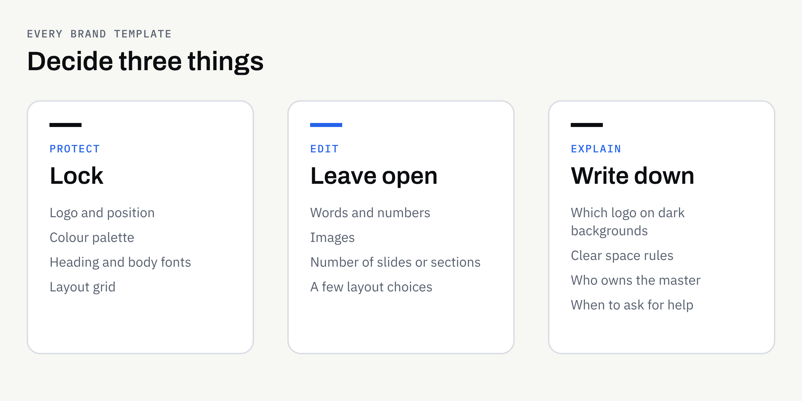

A good brand does not stay good by itself. Once the logo, colours and fonts are agreed, someone in your team has to build the next slide deck on a busy afternoon. Someone else needs a social post by lunchtime. A third person opens an old quote, changes the name and sends it.

None of them is trying to dilute your brand. They are doing the quickest thing available. If the quickest thing is a blank page, you get blank-page results.

Templates change what "quickest" means. This guide covers which ones are worth having, what a good one contains and how to hand them over so they are still used a year from now.

## Why do templates matter more than guidelines?

Brand guidelines tell people what is right. Templates make it the easy option. Our guide to [what to include in brand guidelines](https://fintaxtech.co.uk/blog/what-to-include-in-brand-guidelines/) covers the reference document; templates are the working tools that follow it.

Most people will not read a guidelines PDF before making a slide. They will open the most recent file and adapt it. A template turns that habit to your advantage, because the starting point is already correct.

Templates also save time. Nobody needs to decide where the logo goes, how large a heading should be or which blue to pick. Those decisions were made once, by someone who had the whole brand in mind.

## Which templates are worth having?

Not every business needs a large library. Begin with what your team makes repeatedly, and be honest about what that is.

| Template | Useful when | Typical format |
| --- | --- | --- |
| Slide deck | You pitch, train or report to others | PowerPoint, Keynote or Google Slides |
| Quote or proposal | You send written offers | Word or Google Docs, often exported to PDF |
| Letterhead or document cover | You send formal letters or reports | Word or Google Docs |
| Social post layouts | You post regularly | Canva, or the design tool your team uses |
| Email signature | More than one person sends email | HTML or your email system's signature tool |
| Invoice layout | You raise invoices outside accounting software | Your accounting system or a document template |

For some businesses that is the whole list. Others need a flyer layout, a name badge or an event poster. If the same request has come up three times, it probably deserves a template. If it has come up once, it probably does not.

Our article on [stationery and marketing assets after the logo](https://fintaxtech.co.uk/blog/stationery-and-marketing-assets-after-logo/) helps you decide what to prioritise, and some of those assets are best delivered as templates rather than single files.

## What makes a template work in practice?

A template can look excellent in the designer's software and fall apart in yours. Check these points before you accept any template.

### It opens properly in your software

Ask the designer to build it in the tool your team already uses. A template made in specialist design software may be impossible for your team to edit. Tell the designer early which tools you use, including the version if it matters, and ask them to confirm they have tested the file in that tool.

### Fonts behave themselves

If a template uses a font that is not installed on someone's computer, the software swaps in another one and the layout shifts. Ask which fonts are used, where they come from and whether your licence covers use across your team. Some fonts have separate licences for desktop, web and app use, so check the terms for each. This is not legal advice; confirm what the licence allows in writing.

For templates that must travel to people outside your team, a fallback font is sometimes sensible. Ask your designer what they recommend. Our guide to [choosing brand colours and fonts](https://fintaxtech.co.uk/blog/choosing-brand-colours-and-fonts/) explains why this matters beyond the template itself.

### Colours are saved, not guessed

Brand colours should sit in the template's palette, so people choose from a short list instead of picking by eye. Tell your designer that you want the palette limited to approved colours, with the rest hidden if the software allows it.

### Fixed parts are protected, flexible parts are obvious

The best templates make it clear what can change and what cannot. The logo, footer and layout grid are fixed. Headings, body text and images are open. Where software supports it, fixed elements live on a locked master layout, and content areas carry short prompts such as "Heading, up to six words".

### Sample content shows the intended style

A template filled only with placeholder text gives people no sense of tone or length. One or two worked examples, clearly marked as examples, show how a finished slide or post is meant to look.

## What should you lock, and what should you leave open?

There is a balance here. A template that locks everything is frustrating and gets abandoned. One that locks nothing does not protect anything.

As a rough guide:

- **Lock:** the logo and its position, the colour palette, heading and body fonts and the underlying layout grid.
- **Leave open:** the words, images, numbers, number of slides or sections and the choice between a small set of layouts.
- **Write down:** the rules that software cannot enforce, such as which logo version to use on a dark background or how much space to leave around it.

Locking is never perfect. Someone determined can still break a template, and file formats sometimes behave differently between programs. Treat locking as a way to prevent accidents, not as security.

## How should templates be handed over?

A pack of files in an email attachment is easy to lose. A handover that lasts includes a few extra things.

### Editable files, not only exports

A PDF of a template cannot be used as one. Make sure you receive the editable files, and confirm in writing exactly what is included. The usual position is that ownership of agreed final deliverables passes to you after full payment, as set out in the written proposal. That is not legal advice, so check the terms in your own agreement, and ask about any fonts, stock images or third-party tools involved.

### A one-page guide

Each template needs a short note: what it is for, who should use it, how to save a copy and what not to change. Keep it to a page. If it is longer, people will not read it.

### One home, one owner

Put the templates in the same place as your other brand files, and read our guide to [organising your brand files](https://fintaxtech.co.uk/blog/organising-your-brand-files-and-assets/) if that place does not exist yet. Name one person who looks after them, answers questions and is the only one who changes the master copy.

### A way to save copies

People should open a template, save a copy under a new name and work in the copy. Say so on the guide, and where possible set the file to open as a new document rather than as the original.

## When do templates go wrong?

Most failures are predictable.

- **Too many templates.** If people cannot find the right one in a few seconds, they will start from scratch.
- **Too rigid.** A template that cannot handle a long heading or a missing image will be bent out of shape.
- **Out of date.** A template with an old address or a retired service name quietly spreads the old information.
- **Several versions.** Copies saved on desktops drift from the master. Keep one master and retire the rest.
- **No owner.** When nobody is responsible, nothing is updated and the first workaround becomes the standard.

A short review whenever something changes in the business, such as a new service, a new address or a refreshed look, keeps the set healthy.

## An illustrative example

Imagine, as an invented example rather than a client, a small training company with four people who all build their own course slides. Each deck looks different, and the logo appears in three sizes.

A sensible fix would be a single slide template with five layouts: title, content, image and text, quote and closing. The logo and footer are locked, the palette is limited to the brand colours, and there is a one-page guide saved beside the template. One person owns the file. Nobody becomes a designer, but every deck now starts from the same place.

## Before you accept your templates

Work through this list with your designer before you sign them off.

- [ ] I know which templates I asked for and why each one is needed
- [ ] Each one opens and edits correctly in the software my team uses
- [ ] Someone has tested them on a different computer from the designer's
- [ ] The fonts are listed, and I know what the licences allow
- [ ] Brand colours are saved in the palette
- [ ] The logo and fixed elements are locked where the software allows
- [ ] Editable files are included, not only PDFs
- [ ] There is a one-page guide for each template
- [ ] The templates are stored with our other brand files
- [ ] One named person owns the master copies
- [ ] We know when we will next review them

If you would like templates designed alongside a new or refreshed brand, we can talk through which ones your team would really use. We design the templates and supply the files; you choose the printer for anything that needs printing, and we can supply print-ready files for it.

**[Talk to us about branding →](/enquiry/?service=branding)**
