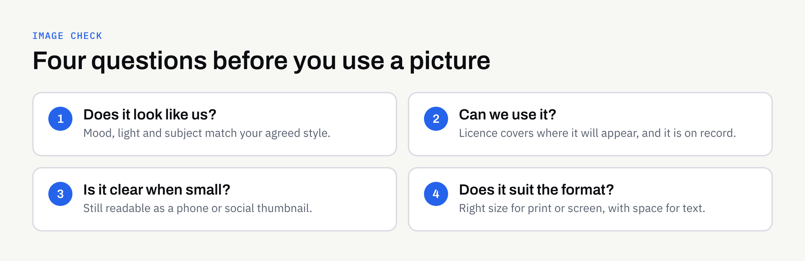

You have a clear logo, sensible colours and a tidy set of fonts. Then you add pictures to your website, brochure and social posts, and everything starts to look like it belongs to different businesses. One photo is bright and staged, the next is dark and casual, and a third is a clip-art style graphic that someone found at the last minute.

Images carry a lot of a brand's personality, yet they are often chosen one at a time, under time pressure. This guide explains how to decide on a consistent image style, how to check that you are allowed to use what you choose, and what to tell a designer so that pictures support the rest of your brand.

## Why imagery is part of the brand, not decoration

People notice pictures before they read words. A photo of a real team in a real workplace says something different from a polished stock image of strangers shaking hands, and neither is automatically right. What matters is that the choice is deliberate and that it matches what you actually do.

Consistent imagery helps in three ways:

- **Recognition:** Customers start to associate a certain look with you, even before they see your logo.
- **Trust:** Pictures that reflect your real work are easier to believe than generic ones.
- **Efficiency:** Once you have a style, choosing the next image is a quick decision rather than a fresh debate.

If you already have brand guidelines, imagery should be covered there. Our guide to [what to include in brand guidelines](https://fintaxtech.co.uk/blog/what-to-include-in-brand-guidelines/) shows where it fits.

## Decide what kind of imagery you need

Before looking at a single photo, list where pictures will actually appear. A website header, a printed leaflet and a social media post each ask different things of an image.

### Photography

Real photographs of your people, premises, products or work. They are the most distinctive option and the hardest to copy, but they need planning and sometimes a professional.

### Stock photography

Licensed images from a library. Useful for topics you cannot photograph yourself, but easy to overuse. Many other businesses may be using the same picture.

### Illustration and graphics

Custom drawings, icons or diagrams. These suit explaining ideas, such as a process or a service, and can be kept consistent with your colours.

### Mixing types

Most small businesses use a blend. That is fine, provided each type has a clear job. For example: real photographs for people and places, simple illustrations for explaining services, and no stock images of people at all.

## Choose a consistent style

A style is a short set of choices that you can describe in a few lines. You do not need a long document. Think about these questions:

- **Subject:** What do we show? People at work, finished products, close-up details, or places?
- **Mood:** Calm, energetic, formal, friendly? Pick two or three words and stick to them.
- **Light and colour:** Bright and natural, or muted and moody? Do pictures lean towards your brand colours?
- **Composition:** Close-up or wide? Is there space left for text to sit on top?
- **People:** Do we show faces? If so, are they real team members or customers who have agreed?

Write the answers down and test them. Pick five existing images and ask whether they would sit comfortably together on one page. If three of them feel like they belong to a different business, the style is not yet clear enough.

## Check you are allowed to use the image

This is the part that is easy to skip and expensive to get wrong. A picture being easy to find online does not mean it is free to use. Photographs are normally protected by copyright, and the owner's permission is generally needed. The UK Government's page on [how copyright protects your work](https://www.gov.uk/copyright) is a sensible starting point.

This is general information, not legal advice. If a licence matters to your business, confirm the terms in writing.

### Questions to ask about any image

- **Who made it?** If you do not know, find out before using it.
- **What does the licence allow?** Some licences cover websites but not printed material. Some limit how many copies you can produce, or ban use on merchandise.
- **Does it need a credit?** Some do. Note it if so.
- **Are there people in it?** If you took the photo yourself, ask the people shown whether they are happy for it to be used for your business, and keep a record of their answer.
- **Is the licence tied to a person or a business?** If an employee bought it on a personal account, the business may not be covered.

### Keep a simple record

For every image you use, note where it came from, the licence terms and the date. A short spreadsheet is enough. It saves a great deal of time if a question comes up later, or if you change supplier. Our guide to [organising your brand files](https://fintaxtech.co.uk/blog/organising-your-brand-files-and-assets/) suggests a place for it.

## Plan a small photo shoot instead of buying one-offs

If real photographs fit your brand, a single planned session often gives you more usable material than lots of separate purchases. You do not need a huge budget to plan well.

1. **Write a shot list.** List the pictures you need: team portraits, the workspace, products in use, details of the work.
2. **Think about the formats.** A wide image for a website header, a square for social posts and a tall one for print all need different framing. Ask for variations.
3. **Leave space for text.** Some shots should have empty areas where headlines can sit.
4. **Agree usage in writing.** Confirm with the photographer where and for how long you can use the pictures, and who owns the final files.
5. **Collect permissions.** Get agreement from anyone who appears in the pictures before the day.

If you prefer, a smaller shoot with a phone and good daylight can work for informal brands, as long as it follows the same style rules.

## Make pictures work on screen and in print

An image that looks good in a camera roll can still fail in use. Check these practical points before an image goes into a design.

### Size and quality

Print generally needs larger, higher-quality files than screens. Ask for the original, uncompressed version, not a copy sent through a messaging app. Our guide to [designing for print without owning a press](https://fintaxtech.co.uk/blog/designing-for-print-without-owning-a-press/) explains what a printer usually needs.

### Clarity at small sizes

Social media thumbnails and mobile screens are small. A busy picture with a tiny subject may become a blur. Test a draft at the smallest size it will appear.

### Text over images

If a headline sits on a photograph, make sure it stays readable. Choose images with a calm area, or add a plain panel behind the text. Readability affects everyone, and our article on [website accessibility basics](https://fintaxtech.co.uk/blog/website-accessibility-basics-for-business-owners/) covers related points such as describing images in words for people who cannot see them.

## A quick comparison of image sources

The table below is a general guide. Your own situation, budget and licence terms will decide what suits you best.

| Source | Strengths | Watch out for |
| --- | --- | --- |
| Your own photos | Authentic and distinctive | Quality, and permissions from people shown |
| Commissioned photographer | Consistent, planned set | Agree usage and ownership in writing |
| Stock library | Fast and wide choice | Generic feel; licence limits |
| Custom illustration | Explains ideas, matches brand | Needs a clear style brief |
| Free image sites | No fee | Licence terms vary; check each image |

## What to tell a designer

A designer can only match your style if they know what it is. A short brief is usually enough:

- Three or four example images you like, and one or two you do not
- The mood words you chose
- Where the images will appear (web, print, social, or all three)
- Any images you already own and their licence terms
- Anything that must never be shown, such as certain products or people

When you review the first designs, point to specific images rather than general feelings. Our guide to [giving useful design feedback](https://fintaxtech.co.uk/blog/giving-useful-design-feedback/) offers ways to do that.

FinTaxTech supplies designs as files for you to use or pass to your chosen printer. We can recommend a direction for imagery, but we do not guarantee that a particular image is legally cleared for you, so confirm licence terms with the image source.

## Checklist: before you use an image

- [ ] It fits the mood and style we have agreed
- [ ] We know who made it
- [ ] The licence covers the places we plan to use it
- [ ] We have noted the source, licence and date
- [ ] Anyone shown has agreed, and we have a record
- [ ] It works at the smallest size it will appear
- [ ] Any text on top stays easy to read
- [ ] The file is the right size for print, if it is going to print
- [ ] Brand files include the final approved version

## Next steps

If your pictures do not yet feel like they belong together, the fix is usually a short style note and a clearer way of choosing, not a complete rebuild. If you would like help describing an image style, or designing a set of graphics that matches your brand, we are happy to talk it through with no pressure.

**[Talk to us about brand design →](/enquiry/?service=branding)**
