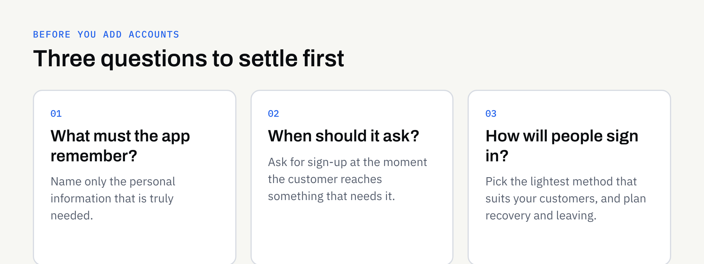

"Users will log in" is one of the most casual lines in an app brief. It sounds like a small detail. In practice, accounts shape the design, the budget, the privacy duties and the day-to-day running of the app.

For some apps, accounts are essential. For others, they are a barrier that stops people getting to the useful part. This guide helps you decide which kind of app yours is, before anyone starts building.

## Why accounts are not a small feature

A login screen is the visible part. Behind it sit several pieces of work that are easy to overlook:

- **Sign-up and sign-in flows**, including what happens when someone forgets their details.
- **Secure storage** of whatever you collect about each person.
- **Account settings**, including a way to change details and to leave.
- **Support**, because someone will be locked out and will contact you.
- **Privacy information** describing what you hold and why.

Each of these needs designing, building, testing and maintaining. They are part of the [ongoing running costs of an app](https://fintaxtech.co.uk/blog/mobile-app-maintenance-after-launch/), not only the initial build.

There is also a cost for the customer. Every extra step before value is a point where someone may give up. An app that asks for an email address and a password before showing anything useful has asked for trust it has not yet earned.

## The question to ask first

Ask: **what does the app need to remember about a person, and for how long?**

If the honest answer is "nothing", you probably do not need accounts. If the answer is "their orders, bookings or progress, on whichever device they use", you probably do.

That one question separates most apps into three broad groups.

### Apps that rarely need accounts

These apps give the same content to everyone, or keep personal information only on the device:

- A directory, menu, price guide or event information app.
- A tool such as a calculator or checklist where the data stays on the phone.
- A reference app for staff or members, where access is controlled another way.

### Apps where accounts usually earn their place

- **Bookings and orders** that must follow the customer across devices.
- **Memberships and loyalty schemes** where each person has their own balance or status.
- **Messaging or community features** where people need an identity.
- **Anything with payments** tied to a person, where records must be linked to the right customer.
- **Personalised content** that is expensive to recreate if someone changes phone.

### Apps in between

Many apps sit in the middle. They work fine for a first-time visitor, but benefit from an account once the person wants to save something or come back to it. That leads to a useful design pattern.

## Ask for an account at the moment of value

Rather than putting a login wall at the front, let people use the app first and ask them to create an account when they reach something that needs one.

An illustrative example: a local service business has an app that shows its services, opening times and prices without any login. The customer is only asked to create an account when they choose to book, because at that point the app genuinely needs to know who they are.

This is sometimes called guest access or deferred sign-up. It tends to feel fairer to the customer, and it gives you a clearer picture of when an account is truly needed. It does need some planning: what happens to a guest's choices once they sign up, and whether a guest can complete a purchase without one.

## Choose the lightest sign-in method that fits

Not every app needs a username and a password. Here are the common options, with what they usually mean for you and your customers.

| Method | How it feels to customers | Things to consider |
| --- | --- | --- |
| Email and password | Familiar, but passwords are forgotten | You need reset flows and secure handling |
| Email link or one-time code | No password to remember | Depends on email or text delivery working reliably |
| Sign in with an existing account (such as Apple or Google) | Quick, one tap | Depends on a third party; some customers prefer not to use it |
| Phone number and code | Quick on a phone | Messages may carry a cost per send |
| Staff or member access managed by you | Customers do not sign up | You create and manage each person |

Which fits depends on who your customers are. A tradesperson booking jobs on a phone may prefer a one-time code. A business with its own staff may want accounts managed centrally. There is no single right answer, and your developer should explain the trade-offs in plain terms.

### A note on third-party sign-in

Using a sign-in service run by another company can shorten the build and spare customers a new password. It also means part of your customer experience depends on that company's rules and availability. The app stores also have their own requirements about sign-in options, which change from time to time. Read the current wording in Apple's [App Store Review Guidelines](https://developer.apple.com/app-store/review/guidelines/) and Google's [Play Console policy pages](https://support.google.com/googleplay/android-developer/topic/9858052), and ask your developer to check them against your plan. As ever, store approval can never be guaranteed.

## Plan the whole life of an account

Most briefs describe how an account starts. Few describe how it ends or changes. Cover the full life cycle:

1. **Creating it.** What is the minimum you need to ask for? Every extra field is another reason to stop.
2. **Signing in again.** What if the customer changes phone or forgets how they signed up?
3. **Changing details.** Can they update their email address or name?
4. **Recovering access.** How do they prove who they are if they are locked out?
5. **Leaving.** Can a customer close their account and have their information removed in line with your policy?
6. **Staff access.** Who on your side can see customer information, and how is that controlled?

The app stores generally expect apps that let people create accounts to give them a way to manage or delete those accounts. The exact requirements are set by each store and can change, so check the official pages above rather than relying on a summary.

## Collect only what you need

Once you hold personal information, data protection rules are likely to apply. The Information Commissioner's Office explains the principles on its [UK GDPR guidance pages](https://ico.org.uk/for-organisations/uk-gdpr-guidance-and-resources/). This is not legal advice. Confirm what applies to your business with a suitably qualified adviser and keep the decisions in writing.

Some practical habits help regardless:

- **Ask for the minimum.** If you do not need a date of birth or an address, do not collect them.
- **Know why you hold each item.** If you cannot say why, question whether to keep it.
- **Say what you collect in plain words**, inside the app and in your privacy information.
- **Decide who looks after the data.** Clients should own their own accounts with any cloud provider and store, and your written proposal should say who is responsible for what.

Sensitive information, such as health or financial details, raises the stakes. If your app might hold anything like that, raise it at the start so the design and the legal advice can take it into account.

## What accounts do to the budget and the timeline

We would not give a figure here, because it depends on the app. What you can say is that accounts typically widen the scope in several places: design (more screens), build (sign-in, settings, recovery), testing (more situations to check on real devices) and support afterwards.

That is one reason [mobile app quotes vary so much](https://fintaxtech.co.uk/blog/why-mobile-app-quotes-vary/). A brief that says "with user accounts" can mean anything from a simple email sign-in to a full membership system. If you are building a first version, it may be worth asking whether a lighter approach would test your idea sooner. Our guide to [an MVP versus a full mobile app](https://fintaxtech.co.uk/blog/mvp-vs-full-mobile-app/) covers how to decide what goes in first.

## Questions to settle before briefing a developer

Take these into your conversation:

- **What must the app remember about each person?** Name only the information that is truly needed.
- **Can the first version work without accounts?** If so, what would you add them for later?
- **At what point should someone be asked to sign up?** Ideally when they reach something that needs it.
- **Which sign-in methods suit my customers?** Consider their devices, habits and confidence.
- **How will people recover access or leave?** Both need a plan.
- **Who can see customer information on our side?** Name roles, not just people.
- **Who owns the accounts the app relies on?** Clients own their domains, repositories, store accounts and cloud accounts.

Add the answers to your [mobile app requirements checklist](https://fintaxtech.co.uk/blog/mobile-app-requirements-checklist/) so the decision appears on paper rather than as an assumption.

## Accounts checklist

- [ ] I can say what the app needs to remember about each person.
- [ ] I have decided whether the first version works without accounts.
- [ ] Sign-up is requested at the point where it is needed.
- [ ] I have chosen a sign-in method that suits my customers.
- [ ] Password reset or account recovery has been planned.
- [ ] Customers have a way to change their details and to leave.
- [ ] I only collect the information the app genuinely needs.
- [ ] I have confirmed privacy and data protection wording with a suitable adviser.
- [ ] I have checked the current app store rules on sign-in and account deletion with my developer.
- [ ] Accounts with stores and cloud providers will be in our own name.

## Talk it through before you build

If you are weighing up an app and are not sure whether it needs accounts, we are happy to talk it through. We build new apps and complete rebuilds for iOS and Android, and we can help you shape the brief before any development begins.

**[Discuss your app idea →](/enquiry/?service=mobile-apps)**
