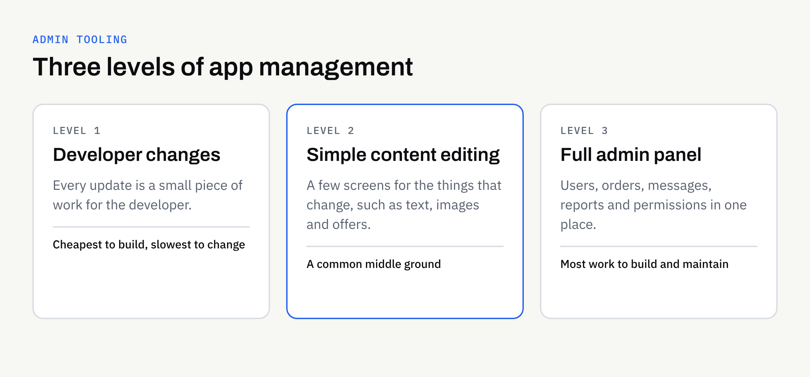

Most app planning focuses on what customers will see. Far less attention goes to the other side: who changes a price, replaces a photo, answers a support request or switches off a user who should no longer have access once the app is live.

That behind-the-scenes control is usually provided by an admin panel. Whether you need one, and how much it should do, is a business decision that affects cost and daily life after launch. This guide helps you settle it before a developer is involved.

## What an admin panel actually is

An admin panel is a private web page, or sometimes a section inside the app, that lets authorised staff manage the app's content and data. Customers never see it. Think of it as the back office of a shop.

It is not the same as the app itself, and it is not the same as a website content management system, although the two can overlap. If you are weighing up that second question for your website, our guide to [whether your website needs a CMS](https://fintaxtech.co.uk/blog/does-your-website-need-a-cms/) covers the website side.

## Why the question matters before you build

If nobody plans for it, there are two common outcomes.

- **Every change needs a developer.** Updating a menu item, an opening time or a notice means a request, a wait and often a bill.
- **Something is bolted on late.** Admin tools added after the build tend to cost more than those designed alongside the app.

Neither is a disaster, but both are easier to avoid with a short conversation early on. It also fits naturally into the wider [mobile app requirements checklist](https://fintaxtech.co.uk/blog/mobile-app-requirements-checklist/).

## What an admin panel can do

Not every app needs every function. Here are the usual building blocks, so you can pick the ones that match your business.

| Function | Example in plain terms | Often needed when |
| --- | --- | --- |
| Edit content | Change text, prices, images or opening hours | Information changes regularly |
| Manage users | View, suspend or remove an account | The app has [user accounts](https://fintaxtech.co.uk/blog/do-you-need-user-accounts-in-your-app/) |
| Handle orders or bookings | See, confirm, cancel or refund | Customers book or buy in the app |
| Send messages | Draft and schedule notices to customers | You plan to use [push notifications](https://fintaxtech.co.uk/blog/push-notifications-without-annoying-people/) |
| View activity | Simple counts and lists of recent activity | You want to see how the app is used |
| Control access | Give each team member only what they need | More than one person manages the app |

The right-hand column is the useful one. If none of those situations apply, a lighter solution may do.

## Three levels to choose from

Admin tooling is not all-or-nothing. It helps to think of three levels.

### Level 1: changes go through the developer

The app is built, and any change is a small piece of work for the developer. This suits apps where content rarely changes, such as a simple information app. It is the cheapest to build and the slowest to change.

### Level 2: simple content editing

A small set of screens lets you edit the few things that change, such as text, images or a list of offers. Everything else stays with the developer. For many small businesses this is the sensible middle ground.

### Level 3: a full admin panel

A fuller tool for managing users, orders, messages and reports. This is worth considering when the app is central to how the business runs, or when several people need different permissions. It is also the most work to design, build and maintain.

None of these is "right" in general. The better question is how often something will change, and how long you can wait for it.

## Questions to answer before you build

Take these to your first conversation with a developer. You do not need technical answers, just honest ones.

1. **What will change after launch?** List things such as prices, photos, offers and opening times.
2. **How often?** Daily, monthly or once a year makes a real difference to the case for a panel.
3. **Who will make the changes?** A named person, not "the team".
4. **What happens when that person is away?** Decide whether a second person needs access.
5. **What must staff never be able to do?** For example, view payment details or delete records.
6. **Do you need a record of who changed what?** Useful if mistakes would be costly.

### Think about roles

If more than one person will use the panel, decide what each can see and do. A common pattern is a small number of full administrators and a larger group who can only edit content. Giving everyone full access is quick to set up but makes accidents and misuse more likely.

## Personal data and responsibility

An admin panel often shows customers' names, contact details or order history. That makes it a place where personal data is handled, so it deserves the same care as the app.

- Give access only to people who need it.
- Remove access promptly when someone leaves.
- Decide how staff sign in and how passwords are managed.

The UK Information Commissioner's Office publishes guidance on the basics of data protection for small organisations at [ico.org.uk](https://ico.org.uk/for-organisations/). This article is not legal advice, so confirm your obligations with a suitably qualified adviser.

## Ownership and accounts

Your admin panel should sit under accounts that you own. Hosting, databases and sign-in services should be in your name, with the developer given access rather than the other way round. Clients own their own domains, repositories, store accounts and cloud accounts, and ownership of the agreed final deliverables passes to you after full payment, as set out in the written proposal. Confirm both points in writing before work starts.

## Do not forget maintenance

An admin panel is part of the app, so it needs the same care afterwards. Security updates, changes to hosting and new requirements all apply. Our article on [what happens after your mobile app launches](https://fintaxtech.co.uk/blog/mobile-app-maintenance-after-launch/) explains the ongoing responsibilities, and it is worth reading before you decide how much to build.

## Common mistakes

- **Building everything "just in case".** Features nobody uses still cost money to build and maintain.
- **Building nothing and regretting it.** Paying for every small text change quickly adds up.
- **Sharing one login.** You lose track of who did what and cannot remove one person without affecting everyone.
- **Forgetting the human side.** A tool is only useful if someone is responsible for using it.

## A short checklist before you brief a developer

Use this as the last step before you write your brief.

- [ ] I have listed what will need to change after launch.
- [ ] I know roughly how often each item changes.
- [ ] I have named who will make the changes, and a back-up.
- [ ] I have chosen Level 1, 2 or 3 as a starting point.
- [ ] I have decided what each person should be able to see and do.
- [ ] I know whether personal data will be visible in the panel.
- [ ] Hosting and database accounts will be in my name.
- [ ] I have asked how the panel will be maintained after launch.

## Talk it through before you build

If you are planning an app and are unsure how much management tooling it needs, we are happy to talk it through. We build new apps and complete rebuilds, and we can help you describe what you need in plain terms. App store approval can never be guaranteed, and we will be clear about what is in and out of scope in the written proposal.

**[Discuss your app project →](/enquiry/?service=mobile-apps)**
