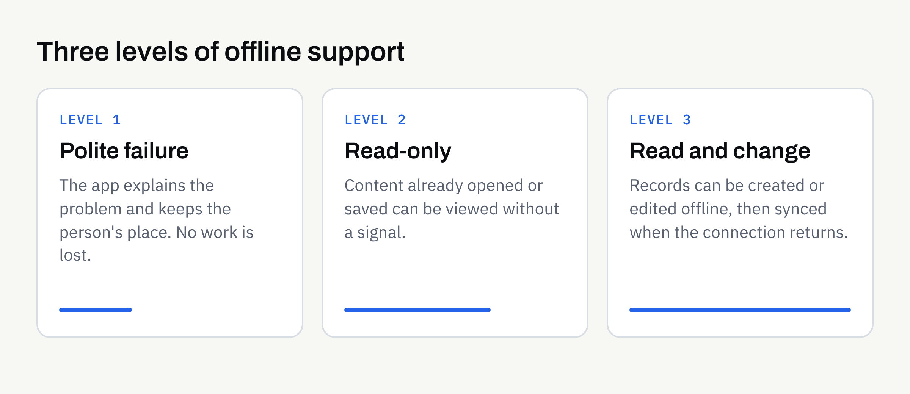

Most apps are planned by people sitting at a desk with fast Wi-Fi. Most apps are used on trains, in car parks, in basements, in rural areas and in buildings where the signal comes and goes. The gap between those two situations is where the question of offline working lives.

"Should it work offline?" sounds like a technical question, but the answer mostly depends on your customers and what they are trying to do. This article helps you make that decision before a developer is involved, so the brief says what you actually need rather than leaving it to assumption.

## What "offline" really means

People use the word to describe several different things, and mixing them up is one of the quickest ways to a misunderstanding over scope.

- **Viewing saved content.** The app shows information that was already downloaded, such as a menu, a timetable or an order history.
- **Doing things without a signal.** The person can create or change something, such as filling in a form or ticking off a task, and the app keeps it safely on the phone.
- **Catching up later.** When the connection returns, the app sends the changes to your system and fetches anything new. This is usually called syncing.
- **Coping gracefully with a weak connection.** The app does not freeze or lose work when the signal drops halfway through.

Android's developer documentation describes an offline-first app as one that can perform all, or a critical subset, of its core functionality without internet access. You can read their explanation in [Build an offline-first app](https://developer.android.com/topic/architecture/data-layer/offline-first). Notice the phrase "a critical subset". Very few apps need everything to work offline, and asking for everything is rarely sensible.

## Who needs it and who does not

Start with the people using the app, not with the technology. The more the app is used away from a reliable connection, the stronger the case.

### Situations where offline working often matters

- **Field work.** Staff who inspect, deliver, survey or install, often in places with poor coverage.
- **Travel and events.** Tickets, itineraries, maps and schedules that must open when the venue network is overloaded.
- **Reference material.** Guides, checklists and manuals someone may need in a hurry.
- **Anything where lost work hurts.** A long form that vanishes when the signal drops is frustrating at best.

### Situations where it may not be worth the cost

- **Live information.** Stock levels, availability or prices that are wrong the moment they are cached.
- **Payments and bookings.** Actions that need an immediate answer from your system.
- **Social and messaging features.** The whole point is current content.
- **A first version that is still testing the idea.** A clear message saying "you appear to be offline" may be enough to begin with.

Our guide to [an MVP versus a full mobile app](https://fintaxtech.co.uk/blog/mvp-vs-full-mobile-app/) is worth keeping in mind here. Offline support is a good example of something that can be added in a later release if your customers show they need it.

## The three levels of offline support

It helps to think of offline support as a ladder. Each step is more useful to the customer and more work to design, build and test. The table below is illustrative, not a quote.

| Level | What the customer can do without a signal | What it involves |
| --- | --- | --- |
| **1. Polite failure** | Nothing, but the app explains what is wrong and keeps their place | Clear messages, no lost input |
| **2. Read-only** | View content they have already opened or chosen to save | Deciding what to store on the phone and how long it stays |
| **3. Read and change** | Create or edit records, then sync later | Storage, sync rules and handling of conflicts |

Level 1 should be the minimum for any app. Level 3 is the most demanding, because two people can change the same record while offline and the app then has to decide what happens. That decision is a business rule, not a technical detail, and you will need to make it.

## The decisions that start with you

A developer can build any of these levels. What they cannot do is decide your rules for you.

### What must be available?

List the screens or tasks that genuinely need to work without a signal. Be specific: "view today's job list and customer address" is useful; "the whole app" is not. This is the "critical subset" in practice.

### How fresh does the information need to be?

Saved information gets out of date. A staff rota saved yesterday may be wrong today. Decide whether it is acceptable to show older information, and whether the app should show when it was last updated, so nobody mistakes old data for current data.

### What happens if two changes clash?

If a customer edits their details on the app while your team edits them on a computer, which version wins? Options include the latest change, the change from a particular source, or asking the person to choose. Pick a rule before the build, not during testing.

### How much can be stored on the phone?

Photos, documents and maps take up space. Customers notice when an app uses a lot of storage, and may remove it. Decide what is saved automatically and what the person chooses to download.

### What about privacy and security?

Anything saved offline sits on the customer's own device. If it includes personal information, consider whether it should be saved at all, and how it is protected if the phone is lost. Data protection rules are likely to apply once you hold personal information. The Information Commissioner's Office explains the principles on its [UK GDPR guidance pages](https://ico.org.uk/for-organisations/uk-gdpr-guidance-and-resources/). This is not legal advice. Confirm what applies to your business with a suitably qualified adviser, and keep the decisions in writing.

If your app has sign-in, read our article on [whether you need user accounts in your app](https://fintaxtech.co.uk/blog/do-you-need-user-accounts-in-your-app/), because offline use raises questions about how long someone stays signed in.

## How offline affects budget and timeline

We would not give a figure here, because it depends entirely on the app. What can be said is that offline support usually widens the scope in several places:

- **Design:** more states to plan, such as offline, syncing, failed and up to date.
- **Build:** local storage and sync logic.
- **Testing:** more situations to check on real devices, including poor connections and switching between them.
- **Support afterwards:** more things that can go slightly wrong in the real world.

This is one reason [mobile app quotes vary so much](https://fintaxtech.co.uk/blog/why-mobile-app-quotes-vary/). A brief that says "should work offline" can mean anything from a friendly error message to a full sync system. If you do not say which, each developer will quote for their own guess.

It also affects how you think about [maintenance after launch](https://fintaxtech.co.uk/blog/mobile-app-maintenance-after-launch/), since changes to your data structure later may need to be handled carefully for people who have not opened the app for a while.

## Testing offline behaviour

Offline problems rarely show up in an office. Ask how the app will be tested for:

- **No connection at all.** Aeroplane mode, with the app opened from scratch.
- **A connection that disappears halfway through a task.** Does the work survive?
- **A slow or patchy connection.** Does the app wait sensibly or hang?
- **Returning online.** Does syncing happen once, correctly, without duplicates?
- **Older app versions.** What happens to saved data after an update?

Be realistic about the outcome. No developer can promise that every offline situation will behave perfectly, and app store approval can never be guaranteed either. What you can ask for is that the agreed behaviour is written down and tested against it.

## Questions to take to your developer

- **Which tasks must work with no signal?** Name them.
- **What level of offline support do we need first?** Level 1, 2 or 3.
- **How will customers know they are offline?** And that their changes are safe?
- **Which of our rules decides clashes?** Latest change wins, or something else?
- **What is stored on the phone, and for how long?** Is any of it personal?
- **How will you test it?** On which devices and conditions?

Add the answers to your [mobile app requirements checklist](https://fintaxtech.co.uk/blog/mobile-app-requirements-checklist/) so the decision is on paper and not an assumption.

## Offline planning checklist

- [ ] I know where and when my customers use the app, including places with poor signal.
- [ ] I have listed the tasks that genuinely need to work without a connection.
- [ ] I have chosen a level of offline support for the first version.
- [ ] I have decided how fresh saved information needs to be.
- [ ] I have a rule for what happens when two changes clash.
- [ ] I know what will be stored on the phone and whether any of it is personal.
- [ ] I have asked how offline behaviour will be tested.
- [ ] I understand that offline support affects design, build, testing and support.
- [ ] Any later additions, such as full syncing, are noted as a possible next release.

## Talk it through before you build

If you are weighing up an app and are not sure how much of it should work without a signal, we are happy to talk it through. We build new apps and complete rebuilds for iOS and Android, and we can help you shape the brief before any development begins.

**[Discuss your app idea →](/enquiry/?service=mobile-apps)**
