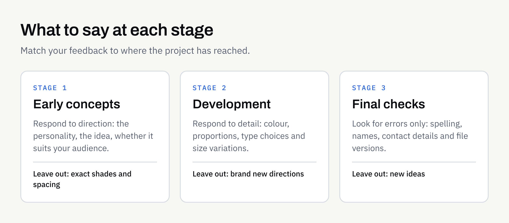

You have been sent the first logo concepts. Something about them is not right, but you cannot quite say what. So you reply with "can it be a bit bolder?" or "I'm not sure, it just doesn't feel like us".

That reaction is completely normal. It is also the single most common reason design projects drift. Feedback that is hard to act on leads to guesses, and guesses lead to another round.

This guide explains how to give feedback that a designer can actually use: what to look at first, how to describe problems rather than prescribe fixes, and how to bring several opinions together before you reply.

## Why vague feedback slows things down

A designer cannot see inside your head. When the feedback is "make it pop", they have to guess what "pop" means to you. It might mean brighter colour, larger type, more contrast or more space. Each guess takes time, and each wrong guess uses up a round of revisions.

Vague comments tend to fall into three groups:

- **Taste words:** "Fresher", "more modern", "cleaner", "friendlier". These are useful as a direction but not as an instruction.
- **Gut reactions:** "I don't love it". That is a valid feeling, but it does not say what to change.
- **Solutions disguised as feedback:** "Make the logo 20% bigger and move it left". This may fix a symptom while the real problem, such as a weak layout, stays untouched.

The fix is not to hide your feelings. It is to follow each feeling with a reason.

## Start with the brief, not your first impression

Before you comment on anything, go back to the brief. If you wrote one, read it again. Our guide to [writing a logo design brief](https://fintaxtech.co.uk/blog/how-to-write-a-logo-design-brief/) explains what a good one covers.

Then ask three questions of each concept:

1. **Does it do the job?** Is it clear who you are and what you do, to the audience you named?
2. **Does it fit where it will be used?** Think about a small social media picture, an invoice header, a sign, a website.
3. **Does it match the personality you described?** If you asked for approachable and calm, does it feel that way?

A concept can fail your personal taste and still pass all three tests. It can also look lovely and fail the first. Judging against the brief keeps the conversation about the business rather than about preference.

## Describe the problem, not the fix

The most useful feedback tells the designer what you notice and why it worries you. They are trained to find solutions; you are the expert on your customers and your business.

The table below shows how to turn common comments into something actionable. The examples are illustrative.

| Unhelpful | More useful |
| --- | --- |
| "Make it pop." | "The logo gets lost on our white website header. Can we test it with stronger contrast?" |
| "It looks too corporate." | "Our customers are mostly families. The sharp edges feel formal — can we explore something softer?" |
| "I don't like the blue." | "Blue reminds me of a competitor. Can we look at colours that set us apart?" |
| "Make the text bigger." | "I can't read the business name when the logo is small on a phone. Can we check it at that size?" |
| "It feels off." | "The symbol and the name seem to belong to different brands. Can we make them feel more connected?" |

Notice the pattern: observation, reason, then an open question. You do not need design vocabulary. Plain language about how something looks and what concerns you is enough.

If you do have a specific idea, share it as a suggestion, such as "I wondered about a rounder typeface — is that worth exploring?", so the designer can weigh it against the rest of the design.

## Separate facts, preferences and opinions of others

Not all feedback carries the same weight. Sorting it into three kinds helps you decide what matters most.

### Facts

These can be checked. The business name is spelt wrongly. The phone number is old. The logo cannot be read at small size. Facts should always be corrected.

### Your own preferences

These are your honest reactions, such as "I find this too serious". They matter, because you will live with the result. Say them, but say why.

### Other people's opinions

Your partner, your team and your friends will all have views. Some will be helpful, particularly if they represent your customers. Others will simply reflect personal taste. Ask yourself whether a comment helps your customers or only pleases the person who made it.

A useful test: if ten comments disagree, go back to the brief and let it decide.

## Bring everyone's feedback into one reply

Several people sending separate comments is a common source of delay. Designers then receive conflicting instructions, such as one person wanting a bigger symbol and another wanting it removed, and have to guess which wins.

Instead, name one person to collect, discuss and resolve comments, and send a single message. If your team disagrees, settle it before you reply.

A simple routine:

1. Share the concepts with everyone at the same time, along with the brief.
2. Ask each person to write down their reactions separately, before they talk to others.
3. Meet briefly, or compare notes, and resolve any conflicts.
4. Send one consolidated message, with the most important points first.

Doing this once, properly, usually saves more time than several quick rounds of replies.

## Look at it in the real world

A design on a large screen, centred on a blank page, tells you very little. Before you reply, see it where it will be used.

- Shrink it to the size of a social media profile picture.
- View it on your phone.
- Print a page at actual size, if you can.
- Place it next to your existing materials or competitors' materials, to check it stands out.
- Look at it in black and white, to see if it still works without colour.

These checks often reveal real problems that would never show up on a large screen, and they give you concrete things to say. If colour and type are the issue, our guide to [choosing brand colours and fonts](https://fintaxtech.co.uk/blog/choosing-brand-colours-and-fonts/) covers how they behave across screens and print.

## Know where you are in the process

The right kind of feedback depends on the stage.

- **Early concepts:** Respond to direction. Is this the right personality? Is it the right idea? Avoid detailed comments on spacing or shades, because those will change.
- **Development:** Respond to detail. Colour, proportions, type choices and variations.
- **Final checks:** Look for errors only. Spelling, contact details, file versions. New ideas at this point reopen the whole project.

Introducing a brand new direction late in the project is the quickest way to extend it. If you realise your business has changed, it is better to say so and discuss it openly than to hint at it through small tweaks. A larger shift may mean you are really asking whether to [rebrand or refresh](https://fintaxtech.co.uk/blog/rebrand-or-refresh-your-business-brand/).

How many revisions are included, and how extra changes are handled, should be set out in your written proposal. This is not legal advice, so confirm the terms in writing before work begins and refer back to them if you are unsure.

## Be honest about what you do not know

You do not have to be sure. "I like the symbol but I'm uneasy about the lettering, and I can't say why" is useful feedback. A good designer will ask questions, show alternatives and help you pin down the concern.

It is also fine to say you need time. Sleeping on a design often gives a clearer view than an immediate reply, and a short pause is cheaper than a wrong turn.

## A feedback checklist

Before you send your reply, check each of these:

- [ ] I have re-read the original brief.
- [ ] I have judged each concept against the audience, the use and the personality in the brief.
- [ ] Every comment says what I notice and why it matters.
- [ ] I have described problems, and offered ideas as suggestions rather than instructions.
- [ ] Spelling, names and contact details have been checked.
- [ ] I have viewed the design small, on a phone and in black and white.
- [ ] Everyone who needs to have their say has done so, and conflicts are resolved.
- [ ] My feedback comes in one message, with the most important points first.
- [ ] My comments fit the stage the project has reached.
- [ ] I know what my proposal says about revisions.

## Working with FinTaxTech

At FinTaxTech we design logo systems, brand direction and stationery and marketing assets, supplied as print-ready files for your chosen printer. Clear feedback is a big part of how those projects run smoothly. Branding work does not confer a trade mark or any exclusivity guarantee, so if that matters to you, take separate advice.

If you are planning branding or design work and would like to talk through how it would run, we would be glad to hear from you.

**[Discuss your branding project →](/enquiry/?service=branding)**
