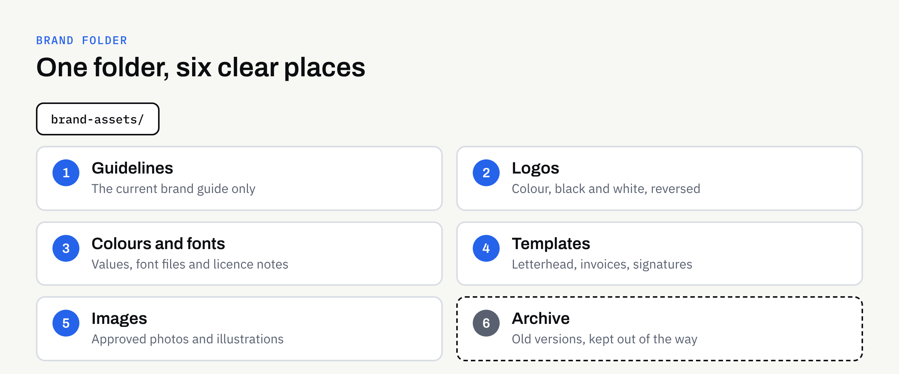

Your printer needs a logo for a banner. Your web developer wants the brand fonts. A new team member asks which blue is the right one. And somewhere in your email there are four files called "logo-final", none of which is quite the same.

This is one of the most common brand problems, and it has nothing to do with design quality. It is about where the files live. A good logo that nobody can find in the right format gets used badly, or not at all.

This guide explains a simple way to organise your brand files, what to put in each folder and how to keep the whole thing tidy without turning it into a project.

## Why scattered brand files cause real problems

When files are hard to find, people improvise. They screenshot the logo from your website, pick a font that looks close, or reuse an old version because it is the one in their downloads folder.

The result is small inconsistencies that add up: a logo that looks slightly stretched, a colour that is a shade off, a letterhead using last year's wording. None of these is serious alone. Together they make a business look less careful than it is.

A single, clearly named home for brand files helps in three ways:

- **Consistency:** Everyone starts from the same approved versions.
- **Speed:** Suppliers get what they need in one message rather than a week of back and forth.
- **Continuity:** If someone leaves, or you change supplier, nothing important lives only on one person's laptop.

## Decide what counts as a brand asset

Not everything you have ever made belongs in the brand folder. Keep it to approved, reusable items. A useful rule is: if a supplier or colleague might need it again, and it is final, it belongs here.

Typically that means:

- Logo files in the formats you need (our guide to [logo file formats](https://fintaxtech.co.uk/blog/logo-file-formats-explained/) explains which are worth having)
- Brand guidelines, whether a short one-page guide or a longer document (see [what to include in brand guidelines](https://fintaxtech.co.uk/blog/what-to-include-in-brand-guidelines/))
- Colour values and font files, or details of where the fonts come from
- Templates, such as letterhead, invoice, email signature and social media graphics
- Approved supporting images, such as team photos or product shots

Drafts, rejected concepts and working files are useful to keep, but they belong somewhere separate so nobody picks one up by mistake.

## A simple folder structure

You do not need a complicated system. Aim for a structure that someone new could understand in under a minute. Here is one that works for many small businesses.

### Numbered top-level folders

Numbering keeps the folders in a sensible order, whatever the software. Use the same names for everyone.

1. **Guidelines:** The current brand guide, and nothing else.
2. **Logos:** Final logo files, sorted into sub-folders such as colour, black and white, and reversed (light logo for dark backgrounds).
3. **Colours and fonts:** Colour values and font files or licence details.
4. **Templates:** Editable files for everyday documents.
5. **Images:** Approved photography and illustrations.
6. **Archive:** Old versions, retired logos and superseded guidelines.

The archive folder matters more than it looks. It gives people somewhere to move old files rather than delete them, and it keeps the live folders free of confusing near-duplicates.

## Name files so they explain themselves

A good file name tells you what you are holding without opening it. A consistent pattern helps, for example:

`business-name_logo_primary_colour.svg`

`business-name_logo_primary_reversed.png`

A few habits make names more useful:

- Use lowercase letters and hyphens or underscores, not spaces or special characters, which can cause trouble on websites and with some software.
- Say what the file is, not how you feel about it. Avoid "final", "new" and "latest".
- Add a date or version number only to files that genuinely change, such as the guidelines.
- Keep names short enough to read in an email attachment list.

## Share the right things with the right people

Different suppliers need different parts of the folder. Sending everything is slower for them and riskier for you.

| Who needs it | What they usually need |
| --- | --- |
| Printer | Print-ready artwork supplied by your designer, plus the colour details in your guidelines |
| Web developer | Logo files in screen formats, colour values, font files or sources, approved images |
| Social media helper | Logo variations, colour values, social templates, image library |
| New team member | The guidelines, email signature and document templates |
| Designer | Everything, including editable source files |

FinTaxTech designs brand and marketing assets but does not print; we supply designs as print-ready files for the printer you choose. Whoever prints your work, it helps to send them the specific artwork file rather than asking them to find a logo from the full set. Our article on [designing for print without owning a press](https://fintaxtech.co.uk/blog/designing-for-print-without-owning-a-press/) covers what to hand over.

## Think about fonts and licences

Fonts are the asset most often forgotten. Some are free to use, some need a licence, and licence terms can differ between desktop use, websites and apps. The brand folder should record which fonts you use, where they came from and what the licence allows.

This is not legal advice. If you are unsure whether a font, photo or other asset can be used in a particular way, check the terms with the supplier or the official source, and keep a copy of the licence with the files.

## Choose where the folder lives

The best location is the one your team will actually use. Shared cloud storage works well for most small businesses because it avoids the "which version is on whose laptop" problem.

Some points to consider:

- **Ownership:** The folder should sit in an account the business controls, not a personal account that disappears when someone leaves.
- **Access:** Let most people view and download, and let only one or two people add or change files.
- **Backups:** Make sure the folder is covered by whatever backup arrangement you already have.

As with websites and apps, it is good practice for the business to own and control its own accounts. Agreed final deliverables from a design project normally pass to you after full payment, as set out in the written proposal, so confirm the terms in writing and make sure the final files are delivered in a form you can keep.

## Keep it tidy with a light routine

Systems fail when they need constant attention. A small routine is enough:

- When a new final file arrives, put it in the right folder and move the old version to the archive.
- Once or twice a year, spend ten minutes checking the folder against your live website and printed materials.
- If you refresh your look, replace the contents in one go. Our article on whether to [rebrand or refresh](https://fintaxtech.co.uk/blog/rebrand-or-refresh-your-business-brand/) can help you decide how much needs to change.

Nominate one person to look after the folder. It does not take long, but it needs an owner.

## Common mistakes to avoid

- **Keeping only one logo format.** A single PNG will not serve every use.
- **Saving files only in email.** Attachments are hard to search and easy to lose.
- **Mixing drafts with finals.** This is the most common cause of the wrong file being used.
- **Forgetting source files.** Editable files are what let a designer make changes later.
- **Giving everyone edit access.** Too many editors usually means too many versions.

## A brand folder checklist

Use this to check where you stand:

- [ ] All final logo files are in one shared place the business controls.
- [ ] There are colour, black and white, and reversed versions of the logo.
- [ ] The current brand guidelines are in the folder, with older versions archived.
- [ ] Colour values and font details are recorded, with licence information.
- [ ] Everyday templates, such as letterhead and email signature, are stored and up to date.
- [ ] File names are clear, consistent and free of words like "final".
- [ ] One person looks after the folder, and only a few people can edit it.
- [ ] Suppliers receive only the files they need for the job.

## Need help pulling your brand together?

If your brand files are scattered, or you are about to start a logo or brand project and want everything delivered in a tidy, usable form, we are happy to talk it through. There is no obligation, and we will tell you plainly what is and is not needed.

**[Talk to us about your brand →](/enquiry/?service=branding)**
