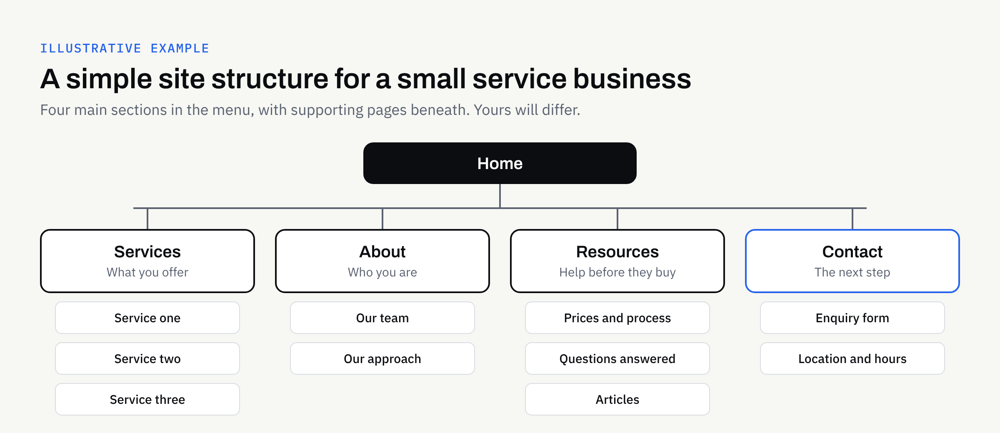

Before a designer chooses a colour or a developer writes a line of code, someone has to decide what pages the website will have and how visitors will move between them. That decision shapes how easy the site is to use, how quickly it can be built and how simple it is to look after.

It is also a decision that belongs largely to you, because you know your customers and your business better than anyone else on the project. This article gives you a practical way to make it, without needing any technical knowledge.

## Why structure comes before design

A website's structure is its map: the list of pages, how they are grouped, and the menu that leads to them. If the map is confused, no amount of good design will stop visitors getting lost.

Structure also affects the work itself. Every page needs content, and every extra page adds writing, images and checking. Agreeing the page list early gives everyone a clear scope. It is one of the client-side decisions we describe in our article on [what slows a website build down](https://fintaxtech.co.uk/blog/what-slows-a-website-build-down/).

## Start with visitor questions, not your organisation chart

It is tempting to organise a website the way your business is organised internally: a page for each department, each team or each product line. Visitors do not think that way. They arrive with a question.

Write down the questions people ask before they get in touch or buy. Typical examples might be:

- What do you do, and is it right for me?
- How does it work, and what happens first?
- Can I see examples of your work?
- How do I get in touch, and where are you?

Group similar questions together. Each group is a candidate for a page or a section. Our guide to [website copy that answers customer questions](https://fintaxtech.co.uk/blog/website-copy-that-answers-customer-questions/) explains how to write the content once the questions are clear.

## Give every page one job

A useful test for any page is to finish this sentence: "This page exists so that a visitor can ..." If you need the word "and" more than once, the page probably has two jobs and may work better as two pages.

The opposite problem is just as common. If two pages answer the same question in slightly different words, visitors will not know which to trust, and you will have to keep both up to date. Merge them.

### Pages most business sites need

Every business is different, but many sites rely on a similar core:

- **Home:** A clear statement of what you do and who it is for, with routes to the most important pages.
- **Services or products:** What you offer, one page per main service where there is enough to say.
- **About:** Who is behind the business and why a visitor might trust you.
- **Contact or enquiry:** The simplest possible route to getting in touch. If you are unsure whether you need more than a form, see [whether you need a booking system or just a contact form](https://fintaxtech.co.uk/blog/do-you-need-a-booking-system-or-a-contact-form/).
- **Supporting pages:** Pricing guidance or process, frequently asked questions, and policy pages such as privacy and cookies.

Policy and legal wording depends on your circumstances. It is not something this article can advise on, so confirm what applies to your business with a qualified adviser.

## Keep the main menu short

A menu is a promise about what the site contains. The more items it offers, the harder each one is to notice. A handful of clear labels is easier to scan than a long row, especially on a phone, where space is tight.

Some practical guidelines:

1. **Put the most important routes first.** Visitors usually look at the start and end of a list most carefully.
2. **Group related pages.** A "Services" section with sub-pages is easier to understand than six separate menu items.
3. **Make the next step visible.** Many sites give the enquiry route its own button or highlighted item.
4. **Use the footer for the rest.** Policies, accessibility information and rarely needed pages can sit lower down.

The diagram above is illustrative only. A sole trader with one service may need far fewer pages, while a business with many services may need more. The principle is the same: a small number of clear sections, with supporting pages beneath.

## Name pages in your customers' words

Menu labels should make sense to someone who has never heard of you. "Solutions", "Our ethos" and "Offerings" are vague. "Services", "About us" and "Prices" are plain.

A good check is to ask someone outside the business to look at the labels alone and say what they would expect to find behind each one. If they hesitate, rewrite the label. Plain labels also help people using screen readers, as we explain in our guide to [website accessibility basics](https://fintaxtech.co.uk/blog/website-accessibility-basics-for-business-owners/).

## Decide the shape of the content, not just the names

Once you have a page list, add a few notes to each page. This turns a list of names into a brief a designer and developer can use.

| Page | Its one job | Main content needed | Next step for the visitor |
| --- | --- | --- | --- |
| Home | Explain what you do and for whom | Short summary, key services, proof of trust | Choose a service or get in touch |
| Services | Help visitors see what you offer | A description of each service | Make an enquiry |
| About | Build confidence | Your story, your approach | See services or get in touch |
| Contact | Make getting in touch easy | Form, location, opening hours | Send the enquiry |

The "next step" column matters most. A page that leaves a visitor with nowhere to go is a dead end, however well written.

## Plan for growth without building it all now

You may want a blog, a news page, case studies or a shop at some point. You do not have to build them all on day one, but it helps to say so early. A structure that leaves room for a new section is cheaper to extend than one that has to be reorganised.

Agree who will add pages later, and how the new pages will be named and grouped. This also matters if you are considering a [redesign or rebuild](https://fintaxtech.co.uk/blog/redesign-or-rebuild-business-website/): an honest look at which pages visitors actually use is a good starting point for deciding what to keep.

Be careful with links to existing pages. If you are replacing a site and page addresses are changing, ask your builder how old addresses will be handled, so that visitors and bookmarks do not hit error pages. We cannot promise any particular effect on search visibility, and you should be wary of anyone who does.

## Common mistakes

- **Copying a competitor's menu.** Their customers and goals may differ from yours.
- **Hiding the contact route.** If it takes more than one click to reach it, simplify.
- **One giant page.** Long pages can work, but only if they are clearly divided and each section has a purpose.
- **Pages with no owner.** If nobody is responsible for keeping a page accurate, it is better left out.
- **Deciding after the design is approved.** Changing structure late means redoing layouts and content.

## A checklist before you brief your designer

- [ ] I have listed the questions my customers ask before they buy.
- [ ] Each page has one clear job.
- [ ] No two pages answer the same question.
- [ ] The main menu has only a handful of clear items.
- [ ] Menu labels are in plain, customer-friendly words.
- [ ] The enquiry route is easy to find from every page.
- [ ] Every page has a named person who will keep it accurate.
- [ ] I have noted which pages can wait until after launch.
- [ ] I know what content each page needs and who will supply it.
- [ ] I have asked how old page addresses will be handled, if replacing an existing site.

Our [new business website launch checklist](https://fintaxtech.co.uk/blog/new-business-website-launch-checklist/) is a useful companion once the structure is settled and you are preparing to go live.

## Working with FinTaxTech

At FinTaxTech we design and build websites as new builds and complete rebuilds. We do not repair other people's legacy code. We are happy to help you turn your customers' questions into a clear page list and menu before any design begins, and to agree what is in scope in a written proposal.

If you are planning a new website or a rebuild and would like to talk through what you need, we would be glad to hear from you.

**[Discuss your website project →](/enquiry/?service=websites)**
