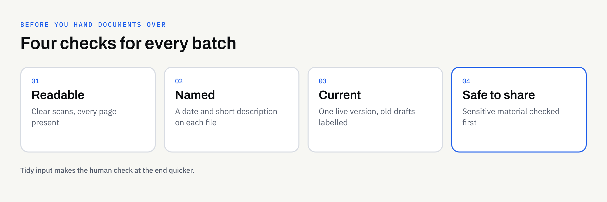

When a business first asks for help with AI-assisted work on its documents, the conversation usually starts with the clever part: what should be extracted, summarised or drafted. The less glamorous question comes later, and it matters just as much: what state are the documents in?

AI-assisted work can only be as good as what it is given. A blurred scan, a folder of files called "final_v2_NEW" or a pile of out-of-date drafts will all make the result worse, however well the task is described. The good news is that a short tidy-up beforehand fixes most of it.

This guide walks through what to check, in plain terms, before you hand any documents to a supplier. No technical knowledge is needed.

## Why preparation changes the result

Think of handing documents to a new member of staff. If the papers are legible, labelled and current, they can start straight away. If they are faded, mixed up with old versions and missing pages, they spend the first week asking questions, or worse, guessing.

AI-assisted work behaves in a similar way. Unclear input tends to produce unclear output, and gaps can be filled with something that merely sounds plausible. Preparation reduces that risk and keeps the human check at the end quicker.

If you are still deciding what to hand over, our guide to [choosing which business tasks to hand to AI first](https://fintaxtech.co.uk/blog/which-business-tasks-to-hand-to-ai-first/) is a useful companion.

## Four checks before you hand anything over

Most preparation comes down to four questions about each batch of documents.

### 1. Is it readable?

Open a few files and look at them as a stranger would.

- **Scans:** Are they straight, complete and sharp enough to read every word, including small print?
- **Photos of paper:** Is the whole page in frame, without shadows or cut-off edges?
- **Pages:** Is every page present and the right way up?
- **Handwriting:** Is it legible to a person? If you struggle to read it, a tool is likely to struggle too.

If a document is hard for you to read, flag it rather than hoping it will work out. Our explanation of [AI document extraction](https://fintaxtech.co.uk/blog/ai-document-extraction-explained/) covers why unclear input needs to be flagged for a person rather than guessed at.

### 2. Is it named and grouped sensibly?

You do not need a perfect filing system. You need enough order that a supplier can tell what each file is.

A simple convention is enough: a date, a document type and a short description, such as `2026-03-12 supplier-contract acme-cleaning`. Group files of the same type together, and keep one folder per batch.

### 3. Is it the current version?

Old drafts are one of the commonest sources of confusion. If three versions of a policy sit side by side, nobody can say which one the work should be based on.

- Keep only the version that is in force, or label each one clearly.
- Remove duplicates.
- Note anything that has been superseded and when.

### 4. Is it safe to share?

Not everything should be handed over. Before sending, decide whether each document contains personal data, financial details, commercially sensitive terms or anything covered by a confidentiality agreement.

Some sensitive or regulated material may be declined by a supplier, and you should raise this early rather than at the point of handover. Our guide to [using AI with confidential business documents](https://fintaxtech.co.uk/blog/ai-confidential-business-documents/) sets out how to think about it.

## A quick triage table

Use this to sort a batch before you start. It is a guide to your own thinking, not a technical test.

| What you find | What to do |
| --- | --- |
| Clear, complete, current file | Include it as it is |
| Blurry or cropped scan | Rescan it if you can; otherwise flag it |
| Missing pages | Find them, or note exactly what is missing |
| Several versions of the same document | Keep the current one and label the rest |
| Contains personal or confidential details | Decide whether it should be shared at all, and raise it with your supplier first |
| Unclear what it is or why it is included | Leave it out until someone can explain it |

## Describe the batch, not just the files

A short covering note makes a surprising difference. It does not need to be long. Four or five lines will do:

- What the batch contains and roughly how many files
- What you want done with it
- Anything you already know is odd, missing or out of date
- Who on your side can answer questions
- When you need it, if there is a date that matters

This works hand in hand with a clear task description. Our article on [repeatable AI workflows](https://fintaxtech.co.uk/blog/repeatable-ai-workflows-for-your-business/) explains how to describe the input, steps, format, rules and check so the same task can be run the same way each time.

## An illustrative example

The following is invented to show the idea. It is not a real client or a real result.

Imagine a small training company that wants a one-page summary of each of its supplier agreements. Before handing anything over, a member of staff gathers the files and finds:

- Two agreements saved twice, once as a scan and once as a Word file
- One scan with the last page missing
- An old version of a contract that was replaced after a renegotiation
- A folder of filenames such as "scan0043"

They keep the current version of each agreement, find the missing page, rename the files by date and supplier, and add a four-line note. The work itself has not started, but a good deal of the risk has already gone.

## What not to do

A few well-meant habits can cause trouble.

- **Do not rewrite documents to make them tidier.** Hand over the originals so the work reflects what they really say.
- **Do not delete things you may need to keep.** Keep your own records as normal. Tidying a copy for handover is different from clearing your files.
- **Do not include everything just in case.** More files mean more to check, and more chances for something sensitive to slip through.
- **Do not assume the first result is final.** Someone on your side should always review what comes back. Our guide to [reviewing AI-assisted content](https://fintaxtech.co.uk/blog/how-to-review-ai-assisted-content/) gives a practical way to do it.

## How this works with FinTaxTech

At FinTaxTech, AI Automation is a managed service. We run the workflow and hand over the finished content; we do not sell prompts or prompt packs. Documents are transferred securely, and only once an engagement is in place, so please do not email batches of files ahead of that.

If your documents arrive in a mixed state, that is normal and we would rather know early. A short conversation about what is in the batch usually saves time later.

## Ownership and written terms

What happens to the documents you supply, and who owns the finished content, should be agreed in writing before work begins. This article is not legal advice. Confirm the terms with your supplier, and take professional advice if your documents carry legal, contractual or regulatory weight.

## Checklist: are your documents ready to hand over?

- [ ] I have opened a sample of files and can read every page clearly
- [ ] Scans are straight, complete and sharp enough for small print
- [ ] No pages are missing, or I have noted exactly which are
- [ ] Files have clear names with a date and a short description
- [ ] Files of the same type are grouped, one folder per batch
- [ ] Duplicates are removed and old versions are labelled or left out
- [ ] I have checked for personal, financial or confidential content
- [ ] I have written a short covering note about the batch
- [ ] A named person on my side can answer questions
- [ ] Ownership and handling terms are agreed in writing

## Next steps

If you have a pile of documents and are wondering whether they are ready for AI-assisted work, we are happy to talk it through with no pressure. Bring a description of what you have, and we can help you work out what to tidy first.

**[Talk to us about AI automation →](/enquiry/?service=ai-automation)**
