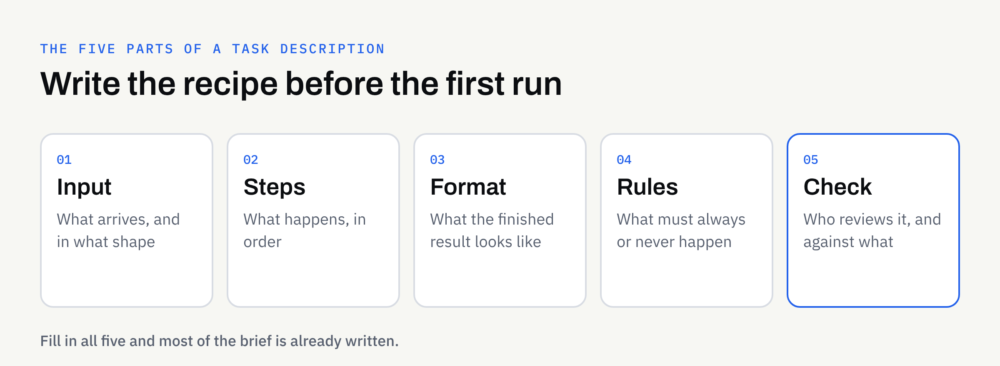

Most people's first experience of AI is a one-off: ask a question, get an answer, move on. That is fine for curiosity. It is much less useful when you need the same kind of job done every week, in the same way, and by someone other than the person who figured it out.

A repeatable workflow is the answer to that problem. This guide explains what one is, how to describe a task so it can be repeated, and what to settle with a supplier before the first run. No technical knowledge is needed.

## What "repeatable" actually means

A repeatable workflow is a task written down clearly enough that it produces the same *kind* of result each time. Notice the wording: the same kind, not the identical words. AI-assisted work varies a little from run to run, so the aim is consistent structure, tone and quality, with a human check at the end.

Think of a recipe card rather than a machine. Anyone who follows the card should end up with a recognisable dish, even if no two plates are identical.

Typical tasks that suit this approach include:

- Summarising each new supplier contract into a one-page overview
- Turning rough meeting notes into a standard write-up
- Pulling the same fields out of incoming forms or letters
- Drafting first versions of routine replies in your usual style

If you are still deciding which of your tasks to hand over first, our guide to [choosing which business tasks to hand to AI first](https://fintaxtech.co.uk/blog/which-business-tasks-to-hand-to-ai-first/) is a good starting point.

## The five parts of a good task description

Every repeatable workflow can be described with the same five parts. If you can fill them in, you have most of a brief already.

### 1. Input: what goes in

Say exactly what arrives and in what shape. A scanned letter, a PDF form, a pasted email and a spreadsheet row are all different starting points.

Note what is usually present and what is sometimes missing. A workflow that assumes every form has a date will behave oddly when one does not.

### 2. Steps: what happens to it

List the steps in order, in plain sentences, as you would explain them to a new colleague. "Read the document, find the parties and dates, list any deadlines, then write the summary" is a clear set of steps. "Make it good" is not.

### 3. Format: what comes out

Describe the finished result: headings, length, order, tone, and anything that must always appear. If you have a standard template, show it. Our article on [keeping your brand voice consistent](https://fintaxtech.co.uk/blog/brand-voice-with-ai-assisted-content/) covers how to describe tone in a way that can be followed.

### 4. Rules: what must always or never happen

Rules turn a vague wish into something checkable. Examples: "always quote the original wording for any deadline", "never guess a missing figure — flag it", or "do not include personal contact details in the summary".

### 5. Check: who looks at it, and against what

Every workflow needs a named person and a short list of things to look for. Without this, mistakes travel quietly into your business. Our guide to [reviewing AI-assisted content](https://fintaxtech.co.uk/blog/how-to-review-ai-assisted-content/) sets out a practical process you can adapt.

## A worked example (illustrative)

The example below is invented to show the shape of a description. It is not a real client or a real result.

Imagine a small letting agency that receives tenancy enquiry emails and wants a consistent internal summary of each.

| Part | What the agency writes down |
| --- | --- |
| Input | A pasted enquiry email, sometimes with a forwarded thread |
| Steps | Identify the sender, the property mentioned, the dates wanted and any questions asked |
| Format | Five short labelled lines, then a suggested reply of no more than 100 words |
| Rules | Never invent a date or price; write "not stated" instead |
| Check | A team member reads each summary before any reply is sent |

None of this is technical. It is a clear instruction written in everyday language, and that clarity is what makes the work repeatable.

## Show good and bad examples

Words alone only get you so far. A few real samples make a workflow much more reliable.

Collect three to five past examples of the task done well, ideally covering the usual cases and one or two awkward ones. If you have an example of what *not* to produce, include that too, with a line explaining the problem.

These samples let both you and your supplier agree what "good" looks like before anything is run. They also give you something to compare future results against.

## Plan for the awkward cases

Real work is messier than the tidy examples. Before you start, decide what should happen when:

- A document is missing a key detail
- Two documents contradict each other
- The input is unreadable or in an unexpected format
- The content looks sensitive or unusual

The safest default is usually to flag the problem for a person rather than let the workflow guess. A workflow that says "I could not find this" is far more useful than one that fills the gap with something plausible.

For documents in particular, our guide to [AI document extraction](https://fintaxtech.co.uk/blog/ai-document-extraction-explained/) explains why clear handling of missing and unclear information matters.

## Keep it consistent over time

A workflow is not finished once it works. Your business changes, and the description should change with it.

### Keep a simple version note

When you alter a rule or a template, write down what changed, when and why. If results suddenly look different, you can then see whether the instructions moved or something else did.

### Review a sample regularly

Pick a few finished items now and then and read them closely, even when nothing seems wrong. Small drifts in tone or detail are easier to correct early.

### Decide who owns the changes

Choose one person on your side who approves any change to the description. Otherwise the workflow slowly collects everyone's preferences and loses its shape.

## How this works with FinTaxTech

At FinTaxTech, AI Automation is a managed service. We run the workflow and hand over the finished content; we do not sell prompts or prompt packs. You describe the job, we agree the five parts with you, and you check what comes back.

A few practical points to keep in mind:

- **Sensitive material:** Some sensitive or regulated documents may be declined, so raise this early.
- **Secure transfer:** Documents are transferred securely, and only once an engagement is in place.
- **Your approval:** Nothing should be relied upon until your named person has checked it.

If your documents are confidential, read our guide to [using AI with confidential business documents](https://fintaxtech.co.uk/blog/ai-confidential-business-documents/) before sharing anything with any supplier.

## Ownership and written terms

Who owns the finished content, and what happens to the instructions and samples you supplied, should be agreed in writing before work begins. This article is not legal advice. Confirm the terms with your supplier, and take professional advice if the content carries legal or regulatory weight.

## Checklist: is your task ready to repeat?

- [ ] I can describe the input and say what it usually looks like
- [ ] The steps are written in plain sentences, in order
- [ ] The finished format is clear, with a template if I have one
- [ ] I have listed the rules: what must always and never happen
- [ ] A named person will check each result, with a short list of things to look for
- [ ] I have three to five good examples, and at least one awkward case
- [ ] I have decided what happens when information is missing or unclear
- [ ] I know who approves changes, and how they will be recorded
- [ ] Ownership of the finished content is agreed in writing

## Next steps

If you have a recurring task and would like to talk through whether it suits a managed AI workflow, we are happy to have a no-pressure conversation. Bring a rough description and a few examples, and we can work out the five parts together.

**[Talk to us about an AI workflow →](/enquiry/?service=ai-automation)**
