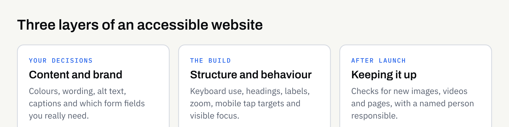

Most business owners think of accessibility as something technical that a developer deals with at the end. In practice, it is a set of decisions made throughout a website project — about colour, wording, layout, forms and how pages behave — and it is far easier to build in at the start than to bolt on later.

This article explains what website accessibility covers, which decisions belong to you rather than your developer, and what to ask for when you commission a new site. It is written for non-technical readers and does not assume any particular platform.

## What website accessibility means

An accessible website is one that as many people as possible can use, whatever their circumstances. That includes people with permanent disabilities, such as low vision, deafness, limited hand movement or dyslexia. It also includes people in temporary or situational difficulty: someone with a broken wrist, someone reading on a phone in bright sunlight, or someone who cannot play sound on a train.

Accessibility is often discussed alongside usability, and the two overlap. A clear page with readable text and a simple form tends to work better for everyone. But they are not identical, and a site can be pleasant for most visitors while still blocking others entirely.

### The standard people refer to

The most widely used reference is the Web Content Accessibility Guidelines, known as WCAG, published by the World Wide Web Consortium (W3C). It sets out testable success criteria at three levels: A, AA and AAA. The W3C's own [WCAG overview](https://www.w3.org/WAI/standards-guidelines/wcag/) explains the current versions and how they relate.

You do not need to read the standard yourself. It is useful to know it exists, because it gives you a shared way to write down what you want. "We would like the site to aim for WCAG 2.2 level AA" is a clearer request than "make it accessible".

## Why it matters to a business

There are practical reasons and responsible ones, and they point the same way.

- **More people can use the site.** Customers who cannot read your text, operate your form or find your phone number are customers you may never hear from.
- **It often improves the basics.** Clear headings, descriptive links and readable text help every visitor.
- **It is part of offering a service fairly.** In the UK, the Equality Act 2010 is relevant to how services are provided to disabled people. The government's [Equality Act 2010 guidance](https://www.gov.uk/guidance/equality-act-2010-guidance) is a starting point. This is not legal advice, and the position for your business depends on your circumstances, so take advice if you are unsure.

Be wary of anyone who promises that a site is "fully compliant" or protects you from every complaint. Accessibility is a matter of degree and of ongoing care, and no build can guarantee an outcome.

## The decisions that start with you

Developers handle much of the technical work, but several of the biggest accessibility factors begin with choices only you can make.

### Colour and contrast

Text needs enough contrast against its background to be readable. Pale grey on white looks elegant in a mock-up and is hard to read on a phone outdoors. If you are choosing a palette, ask for the combinations to be checked, and keep our guide to [choosing brand colours and fonts](https://fintaxtech.co.uk/blog/choosing-brand-colours-and-fonts/) in mind: a palette that works on screen and in real use is also kinder to readers.

Do not rely on colour alone to carry meaning. A form error shown only in red is invisible to some people, so it also needs a message in words.

### Wording

Plain, specific language is an accessibility feature. Link text such as "click here" tells a screen reader user nothing when links are read out in a list; "View our opening hours" does. Headings should describe what follows. Our article on [website copy that answers customer questions](https://fintaxtech.co.uk/blog/website-copy-that-answers-customer-questions/) covers how to write for real readers.

### Images, video and audio

Every meaningful image needs a short text description, called alt text, so that people who cannot see it still get the point. Decorative images should be marked so they are skipped. If you publish video, plan for captions, and consider a transcript. These are content jobs, so decide who will write them before launch.

### Forms

Forms are where accessibility problems cost the most, because a blocked form means a lost enquiry. Each field needs a clear visible label, required fields should be marked, and error messages should say what went wrong and how to fix it. If you are deciding between a form and something more elaborate, see [whether you need a booking system or just a contact form](https://fintaxtech.co.uk/blog/do-you-need-a-booking-system-or-a-contact-form/).

## What the build itself should provide

Some things are the developer's job, but you can still ask about them. A well-built site should offer:

- **Keyboard use.** Everything should work without a mouse, in a sensible order, with a visible indicator showing where you are on the page.
- **Proper structure.** Headings, lists and buttons should use the correct markup so that assistive technology can understand them.
- **A page title and language setting** on every page.
- **Zoom and resizing.** Text should enlarge without breaking the layout or hiding content.
- **Mobile behaviour.** Tap targets should be large enough to use comfortably, and nothing should require precise gestures.

## A quick summary table

| Area | Your decision | What to ask the builder |
| --- | --- | --- |
| Colour | Brand palette and text colours | Have contrast levels been checked? |
| Wording | Headings, link text, plain language | Are links and headings descriptive? |
| Images | Who writes alt text | How are decorative images handled? |
| Video and audio | Captions or transcripts | Can captions be added without extra work later? |
| Forms | Which fields you really need | Are labels, errors and required fields clear? |
| Navigation | Menu structure | Can the whole site be used by keyboard? |
| Testing | What counts as good enough | What was checked, and how? |

## How to check a site yourself

You can do a useful first review without specialist tools. The W3C publishes a set of [easy checks for accessibility](https://www.w3.org/WAI/test-evaluate/easy-checks/) that cover page titles, headings, colour contrast, keyboard focus, zoom, labels and more.

Try these on your own site or on a draft:

1. **Put the mouse aside.** Use the Tab key to move through a page. Can you reach every link, button and form field, and can you see where you are?
2. **Zoom in.** Enlarge the page to 200% in your browser. Does the text stay readable and the layout intact?
3. **View it on a phone, outdoors if you can.** Is the text clear in daylight?
4. **Read the links aloud.** If a list of your link texts makes no sense out of context, rewrite them.
5. **Complete your own form** with a deliberate mistake. Is the error message helpful?

These checks will not find everything, and they do not replace testing by people who use assistive technology. They do show quickly whether accessibility has been considered at all.

## Accessibility after launch

A site that is accessible on launch day can lose that quality through ordinary editing. A new image uploaded without a description, a pale-coloured banner, or a video added without captions all undo earlier work. Agree who is responsible for content standards once the site is live, and keep a short checklist for anyone who updates pages. Our [new business website launch checklist](https://fintaxtech.co.uk/blog/new-business-website-launch-checklist/) is a good companion for the launch stage.

## A checklist for your next website

- [ ] I have said in writing what level of accessibility I would like the site to aim for.
- [ ] Text and background colours have been checked for contrast.
- [ ] Meaning is never carried by colour alone.
- [ ] Links and headings make sense when read out of context.
- [ ] I know who will write alt text and captions.
- [ ] Every form field has a clear label, and error messages explain how to fix the problem.
- [ ] The whole site can be used by keyboard, with a visible focus indicator.
- [ ] Text can be enlarged without breaking the layout.
- [ ] I have tried the easy checks myself on a draft.
- [ ] Someone is responsible for keeping standards up after launch.

## Working with FinTaxTech

At FinTaxTech we design and build websites as new builds and complete rebuilds, and we do not repair other people's legacy code. We take accessibility into account in layout, colour, structure and forms. We cannot promise that any site will suit every visitor or meet a particular legal test, and you should confirm any obligations that apply to your business in writing and, where needed, with professional advice.

If you are planning a new website or a rebuild and would like to talk through what you need, we would be glad to hear from you.

**[Discuss your website project →](/enquiry/?service=websites)**
