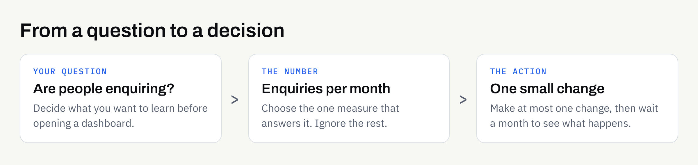

Many business owners ask for analytics when a website is built, then open the dashboard once, see dozens of charts and never return. The problem is rarely the tool. It is that nobody decided in advance which questions the numbers were meant to answer.

This article explains how to choose a small number of useful measures, which popular numbers you can safely ignore, and what to agree with your developer before launch. It is written for non-technical readers and does not assume any particular analytics product.

## Start with questions, not charts

Analytics software records what visitors do on your site. That is useful only if you know what you want to learn. A short list of questions works better than a full dashboard.

Good starting questions for a small business include:

- **Are people finding the site?** Roughly how many visitors arrive, and from which kinds of source (search, social media, direct, other websites)?
- **Are they reaching the pages that matter?** Do visitors look at your services, pricing guidance or contact page, or do they leave from the home page?
- **Are they taking the action you want?** Do enquiries, bookings or calls follow?
- **Is anything getting in the way?** Do many visitors on phones leave quickly, or abandon a form halfway?

If a number does not help answer one of these, it can wait.

## The few numbers worth watching

You do not need to track everything. For most brochure sites, landing pages and small booking sites, a handful of measures covers the ground.

### Visitors and where they come from

Total visits give a rough sense of scale, and the source tells you which channels are doing any work. Treat the figures as approximate. Browser privacy settings, consent choices and blocking tools mean any analytics tool will undercount to some degree.

### Your most-viewed pages

This shows what people actually care about, which is often different from what you expected. If a page you thought was minor attracts steady attention, it may deserve better wording. [Writing website copy that answers the questions customers actually ask](https://fintaxtech.co.uk/blog/website-copy-that-answers-customer-questions/) is a good companion when a popular page is not converting.

### Enquiries and other goals

The most valuable measure is usually not traffic but action: a form sent, a booking made, a phone number tapped, a brochure downloaded. These are often called conversions or goals. Decide which two or three actions count, and make sure each can be recorded. If you are weighing up how people should get in touch, our guide to [whether you need a booking system or just a contact form](https://fintaxtech.co.uk/blog/do-you-need-a-booking-system-or-a-contact-form/) covers the trade-offs.

### Device type

Knowing how many visitors use phones, tablets or desktops helps you judge where to spend design attention. If most visits are on phones, check that your key pages and forms work comfortably on a small screen.

## Numbers you can usually ignore

Some figures look impressive or alarming but rarely lead to a sensible decision for a small site.

| Number | Why to be cautious | What to look at instead |
| --- | --- | --- |
| Total page views | Rises when people click around because they are lost | Enquiries and key-page visits |
| Bounce or engagement rate | Definitions vary by tool, and a quick visit that finds a phone number is a success | Whether the visit ended in an action |
| Average time on page | A long time can mean interest or confusion | The next step visitors took |
| Social media follower counts | Not a website measure at all | Visits that arrive from social platforms |
| Daily ups and downs | Small sites have small numbers, so single days are noisy | Month-by-month trends |

A useful rule: if a figure moves and you would not change anything because of it, stop watching it.

## Privacy, consent and honesty about the data

Analytics usually involves collecting information about visitors, sometimes through cookies or similar technologies. In the UK, rules on this sit alongside data protection law, and the right setup depends on the tool you choose and how it is configured.

This article is not legal advice. Before launch:

- Ask your developer which analytics tool is proposed and what it records.
- Check whether a consent notice is needed for that specific setup, and confirm the position in writing, using the guidance on the [Information Commissioner's Office website](https://ico.org.uk/) as your starting point.
- Make sure your privacy information describes what you actually do.
- Remember that if visitors decline consent, your numbers will be lower. That is expected, not a fault.

Some owners choose a simpler, lower-detail measurement approach because they would rather have fewer numbers and a lighter privacy burden. That is a reasonable choice, and it is worth discussing openly rather than adding every available tracker by default.

## What to agree before your site is built

Analytics is easiest to get right when it is part of the plan rather than an afterthought. Include it in the same conversation as pages, forms and content.

### Decide who owns the accounts

Your analytics account should belong to your business, with your developer given access rather than the other way round. Our article on [who owns your business website after launch](https://fintaxtech.co.uk/blog/who-owns-your-business-website/) explains why this matters when suppliers change. As a general principle, clients should own their own accounts, and the written proposal should say so.

### Decide which actions to record

Write down the two or three actions that count as success, and ask for confirmation that each one is recorded. A form that cannot be tracked, or a button that does nothing measurable, is much cheaper to fix during the build than afterwards.

### Test before launch

Submit a test enquiry, tap the phone link and open the site on a phone, then check that the numbers appear where you expect. Our [new business website launch checklist](https://fintaxtech.co.uk/blog/new-business-website-launch-checklist/) is a sensible place to add this step.

### Choose a review rhythm

A short monthly look is usually enough. Open the dashboard with your questions in front of you, note two or three observations and decide on at most one change. Then leave it alone for a month and see what happens.

## What analytics cannot tell you

Numbers show what happened, not why. They cannot tell you that a visitor was put off by a price, or that your wording confused them. Pair them with real feedback: ask new customers how they found you, and read the questions they send. Small sites often learn more from five honest conversations than from a month of charts.

Analytics also cannot promise results. Watching a number does not move it, and nobody can guarantee search rankings or traffic. Use the figures to make small, sensible improvements, not to chase a target.

## A short checklist before you ask for analytics

- [ ] We have written down the three questions we want the numbers to answer
- [ ] We have chosen two or three actions that count as success, such as an enquiry or a booking
- [ ] Our business owns the analytics account, and the developer has access through it
- [ ] We have asked which tool is proposed and what it records
- [ ] We have confirmed in writing whether a consent notice is needed for that setup
- [ ] Our privacy information matches what the site actually does
- [ ] A test enquiry has been recorded correctly before launch
- [ ] Someone is named to review the numbers once a month

## Talking it through

If you are planning a new website or a complete rebuild and want measurement set up sensibly from the start, we are happy to talk it through. We build new sites and complete rebuilds, and we can help you decide which few numbers are worth tracking. There is no pressure to commit to anything.

**[Plan a website with us →](/enquiry/?service=websites)**
